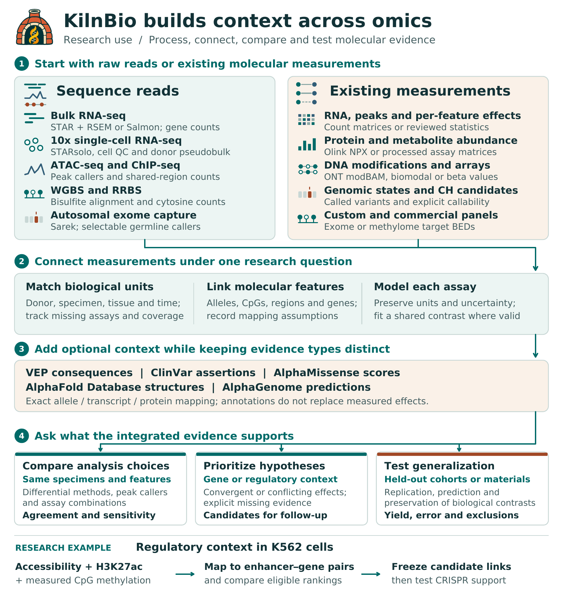

# KilnBio


**Process your omics data, combine evidence across assays, and trace how an analysis changes the targets you would follow up.**

KilnBio brings command-line sequencing tools, R/Bioconductor statistics and Python analysis into one toolkit. Start with sequencing reads or existing measurements. Run a supported workflow, check which samples and features can be compared, and connect results across DNA, methylation, chromatin, RNA and protein.

For example, you can ask whether adding protein measurements changes an RNA-based target list. KilnBio first checks what changes when analysis is restricted to patients who have both assays, then adds protein for those same patients. The output records the patients, genes, filtering rules and ranks behind the answer.

## Download and install

Use **Linux x86-64 or Ubuntu under Windows WSL2** for automatic installation. Start with an approved noncommercial research project. [Permission and use terms](ACCESS.md)

1. Download the [current source ZIP](https://github.com/varunorama/kilnbio-research/archive/refs/heads/main.zip), extract it, and open a terminal in the extracted folder. Alternatively, clone it:

   ```bash
   git clone https://github.com/varunorama/kilnbio-research.git
   cd kilnbio-research
   ```

2. Run the installer:

   ```bash
   bash setup.sh
   ```

   This downloads an isolated Python 3.12 environment, installs the toolkit, and runs a small synthetic donor-matching check. It requires Bash, Python 3.8+ and curl to start. Ubuntu setup, other operating systems, storage requirements and troubleshooting are in the [installation guide](docs/INSTALLATION.md).

3. Check the installed command:

   ```bash
   KILN="$HOME/.local/share/kilnbio/bin/kilnbio"
   "$KILN" --help
   ```

Choose the dependencies for your work by adding a profile to the setup command. Profiles can be combined.

| Your starting point | Automatic setup |
|---|---|
| Sample/feature audits, study planning, synthetic example | `bash setup.sh` |
| Public bladder RNA–protein example | `bash setup.sh --profile bladder` |
| R differential analyses, methylation statistics, Olink and multi-omic matrices | `bash setup.sh --profile analysis` |
| Single-cell matrices and pseudobulk statistics | `bash setup.sh --profile singlecell` |
| FASTQ processing with pinned upstream workflows | `bash setup.sh --profile sequencing` |
| Optional assistant connector dependencies | `bash setup.sh --profile assistant` |
| All managed profiles above | `bash setup.sh --profile all` |

The installer downloads Python/R packages for the selected profiles. The sequencing profile adds Java and Nextflow and checks your container engine. Enable Docker, Apptainer or Singularity on the execution host, then the workflows retrieve their tool containers as needed. References, assay-specific inputs, optional model weights and API credentials are configured for the chosen analysis. [What each profile installs](docs/INSTALLATION.md#dependency-profiles)

## Run your first example

From the source folder, run a small example that needs no downloaded study data:

```bash
KILN="$HOME/.local/share/kilnbio/bin/kilnbio"
"$KILN" assay-audit reach examples/assay_roster.tsv --out first-audit.json
```

The result contains four donors, three with the baseline assay and two with both assays. This demonstrates a question to resolve before combining measurements: who remains in the analysis after requiring the additional assay?

For a real public dataset, follow the [bladder cancer walkthrough](docs/BLADDER_WALKTHROUGH.md). It downloads checksum-verified RNA, protein and mutation tables and returns ranked targets and the changes caused by matching patients and adding protein.

## What you can analyze

| Data | Supported work |
|---|---|
| Bulk RNA-seq | FASTQ processing, quantification routes, DESeq2/edgeR/limma-voom comparisons and enrichment |
| WGBS and RRBS | Bisulfite-read processing, methylation counts and supported DML/DMR methods |
| ATAC-seq and ChIP-seq | Alignment and peak workflows, peak/caller comparisons and differential chromatin analyses |
| 10x single-cell RNA-seq | Gene-expression processing, matrix QC, clustering and donor-level pseudobulk |
| Protein abundance and Olink | Delivered-matrix import, differential models and integration with other measured assays |
| Genomic and capture-panel data | Exome workflow, variant annotation, target BED coverage and research CH candidate interfaces |
| Oxford Nanopore and biomodal | Supported modification-count imports, chemistry-specific QC and downstream interfaces |
| Methylation arrays and biomarkers | Compatible clock scoring, input coverage checks and associated research biomarkers |
| Multiple assays | Specimen/feature matching, exclusion audits, method agreement, target nomination and held-out comparisons |

Each route has its own required inputs and validation scope. Use the [command index](CLI.txt), [analysis guide](docs/USER_GUIDE.md), [cross-omics guide](docs/INTEGRATING_OMICS.md) and [worked recipes](recipes/README.md) to choose the route.

For a configured study, `kilnbio study study.json NEW_RUN` runs declared stages in dependency order. Preview the study before executing it, and resume completed work using the recorded outputs. [Study configuration and examples](docs/STUDY_RUNNER.md)

[](docs/figures/kilnbio-workflow.png)

## Use KilnBio with an assistant

An approved researcher can connect Claude, ChatGPT, Codex or Antigravity to a configured KilnBio project to list pipelines, start runs and inspect output receipts. Your local machine or lab server supplies the analysis compute. [Assistant installation and connection guide](docs/ASSISTANT_SETUP.md)

In a public bladder comparison, a local operator executed analyses from Claude Free, Codex and Antigravity with and without the versioned KilnBio recipe. **All six runs reproduced the same 15 genes in the same order and direction.** Each assistant explained why SRC left the shortlist after restricting RNA to matched patients and returned after adding protein for those patients.

The standalone scripts evaluated **126 genes**, while KilnBio evaluated **129**. The deposited protein labels for `BIRC2`, `PIK3CA` and `PRKCA` had trailing spaces before the separator. The written methods left whitespace handling unspecified. KilnBio trimmed those spaces before validating symbols. All three standalone implementations excluded those genes, and none of the three reached the top 15. Matching the shortlist alone concealed the difference.

KilnBio records the mappings in `antibody_map.tsv` and the eligible gene set in `eligibility.tsv`. Claude flagged the discrepancy when comparing its own output with the recipe. [Questions to ask about a run](docs/ASSISTANT_SETUP.md#check-an-assistants-interpretation-against-a-run)

## Versions and reproducibility

The setup command above installs the source checkout and records its content hash and resolved package versions. The current branch includes development additions beyond the archived manuscript releases.

| Purpose | Version |
|---|---|
| Original glioma, Quartet, K562 and lung examples | [research.1](https://github.com/varunorama/kilnbio-research/releases/tag/v0.2.0-research.1) |
| Bladder recipe and researcher handoff | [research.2](https://github.com/varunorama/kilnbio-research/releases/tag/v0.2.0-research.2) |
| Archived manuscript software distribution | [research.3](https://github.com/varunorama/kilnbio-research/releases/tag/v0.2.0-research.3) |

Use the README and checksum shipped with the named archive when reproducing that release. Optional [AlphaGenome](docs/ALPHAGENOME.md), [VEP/ClinVar/AlphaMissense/AlphaFold annotations](docs/VARIANT_ANNOTATIONS.md) and [capture-panel tools](docs/CAPTURE_PANELS.md) have dedicated setup and input requirements.

KilnBio is intended for research and hypothesis generation. Project-specific noncommercial use requires written permission. Commercial and industry-sponsored use requires separate permission. [License](LICENSE) · [Access](ACCESS.md) · [Research use](docs/RESEARCH_USE.md)

Cite the KilnBio version, the underlying tools and the public data used in your analysis. [Citation](CITATION.cff) · [Third-party notices](THIRD_PARTY_NOTICES.txt)
