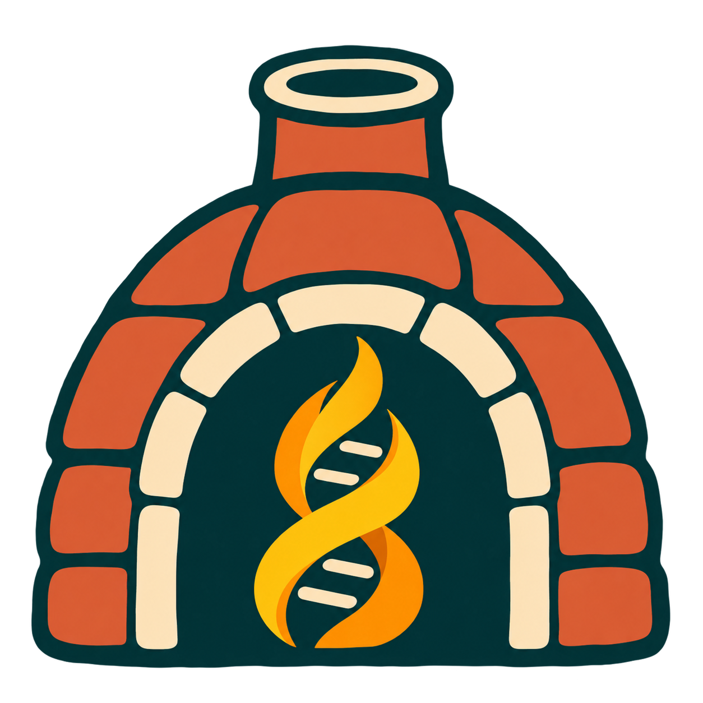

# KilnBio · research release



**Research use only.** KilnBio supports molecular research and hypothesis generation. It has not been validated for clinical diagnosis, patient screening, treatment selection or patient management, and is not intended for diagnostic procedures. [Intended use and interpretation](docs/RESEARCH_USE.md).

**The goal is integration across omics.** Connect genomic variation, methylation, chromatin, RNA and proteins through matched biological units and explicit feature maps. Preserve each assay's units, missingness and uncertainty; use their combined evidence to prioritize research questions and follow-up experiments. [Build biological context across assays](docs/INTEGRATING_OMICS.md).

KilnBio helps researchers process multiple assays and measure whether an assay or analysis choice earns its place in a study. For example, if adding proteomics changes the targets you would follow up, KilnBio lets you separate the effect of adding the measurement from the effect of excluding donors who lack it. It records which specimens can be paired, which targets remain measurable and which directions agree in an independent cohort.

**Release:** [v0.2.0-research.3](https://github.com/varunorama/kilnbio-research/releases/tag/v0.2.0-research.3). The tagged source and release ZIPs are publicly viewable. Running or adapting KilnBio requires written approval for the specific **noncommercial research** project. Read [permitted uses and access](ACCESS.md) and the [license](LICENSE). For commercial or industry-sponsored projects, contact Varun B. Dwaraka before use.

**Targeted sequencing.** Use a Twist Human Methylome, Twist Exome 2.0, or custom target BED to measure depth and identify which variants or measured CpGs lie inside the design. See the [capture-panel guide](docs/CAPTURE_PANELS.md).

**Unreleased platform extensions (research.4-dev).** The source checkout adds [Olink and shared-contrast integration](docs/MULTIOMIC_AND_OLINK.md) and [public-method exome/CH interfaces](docs/EXOME_AND_CH.md). These additions are not in the research.3 ZIP or its manuscript results. Cite the exact commit when evaluating them. Existing release archives remain unchanged.

**One command for a configured study.** `kilnbio study study.json NEW_RUN` connects declared processing, analysis and integration stages in dependency order. A supplied RNA–Olink–methylation teaching recipe needs no new analysis code; other studies retain explicit mappings and model choices. [Run a study, preview it or resume](docs/STUDY_RUNNER.md).

**New to multi-omics analysis?** Start with a supported recipe, sample sheets and a small example. KilnBio supplies reusable processing, statistics and cross-assay checks; study design and unusual data still need scientific judgment. [Who can use it and where to start](docs/ACCESSIBLE_ANALYSIS.md).

**Run a pipeline from your assistant.** Ask KilnBio to list your project's pipelines, start one, and show the completed stages and output files. The same three MCP tools pick up new configured studies as your team adds them. Try the synthetic capture-panel example with Codex, Claude Code or Antigravity, or connect ChatGPT or Claude.ai to your project's running server. [Install and run the example](docs/ASSISTANT_SETUP.md#install-and-run-a-pipeline) · [ChatGPT](docs/ASSISTANT_SETUP.md#chatgpt) · [Claude.ai](docs/ASSISTANT_SETUP.md#claudeai) · [Other MCP clients](docs/ASSISTANT_SETUP.md#cursor-vs-code-and-other-mcp-clients). [Use an existing AWS, Google Cloud or lab VM](docs/ASSISTANT_SETUP.md#use-your-labs-existing-compute) · [Claude Science](docs/ASSISTANT_SETUP.md#claude-science).

**Using Claude Free?** An approved researcher can use Claude Free’s one custom remote connector for KilnBio. With a project-enabled endpoint from your lab, you can start a configured analysis and check its results from ordinary Claude chat. The lab supplies the compute and storage. [Set up KilnBio on Claude Free](docs/ASSISTANT_SETUP.md#run-kilnbio-from-claude-free).

**Optional scientific predictions.** [AlphaGenome 2 variant annotations](docs/ALPHAGENOME.md) are an explicit, separate API step, off by default. The pipeline does not invoke general-purpose LLMs. These model predictions are not measured assays or independent biological validation.

**Variant and protein context.** Optional [VEP, ClinVar, AlphaMissense and AlphaFold Database interfaces](docs/VARIANT_ANNOTATIONS.md) connect called alleles to consequences, submitted assertions, published scores and structural context. These remain separate from measured multi-omic effects. AlphaFold lookup does not run new structure inference.

## Follow your data through KilnBio

[](docs/figures/kilnbio-workflow.png)

Start with reads or existing measurements. KilnBio processes each assay, matches biological units and links features before fitting a shared research contrast. The diagram separates measured evidence from optional annotations and shows the downstream comparisons and validation steps. Support and validation vary by route; see the linked guides.

**Choose the version for your analysis.**

| Example | Version and instructions |
|---|---|
| Glioma, Quartet reference materials, K562 enhancer–gene links, lung adenocarcinoma | [Original research archive](https://github.com/varunorama/kilnbio-research/releases/tag/v0.2.0-research.1) · [Versioned recipe guide](https://github.com/varunorama/kilnbio-research/blob/v0.2.0-research.1/recipes/README.md) |
| TCGA bladder cancer: separate changes due to patient selection from those due to adding protein | [Bladder research archive](https://github.com/varunorama/kilnbio-research/releases/tag/v0.2.0-research.2) · [README shipped in that archive](https://github.com/varunorama/kilnbio-research/blob/v0.2.0-research.2/README.md) |

To reproduce an analysis, use the README inside its named ZIP. You can run the bladder recipe for your own research without completing a form. The timing and return form below are for volunteers evaluating the instructions; their feedback helps maintain the software.

### Researcher handoff: which bladder cancer targets change when you add protein?

Start here to reproduce the bladder analysis using [the research.2 release](https://github.com/varunorama/kilnbio-research/releases/tag/v0.2.0-research.2). You need only the ZIP, its checksum, this README, public internet access, Python 3.10+ and R 4.6.x (tested: Python 3.12 and R 4.6.2). The public release downloads work without a GitHub account. The analysis starts from deposited TCGA RNA abundance, reverse-phase protein arrays (RPPA) and somatic mutation calls, not FASTQs or mass spectrometry. Allow 1 GB of free disk space. No Python packages, Docker, Nextflow or full KilnBio installation are needed for this example.

1. Start your clock. In the download directory check the named ZIP against its companion checksum: on Linux/WSL run `sha256sum -c kilnbio-research-0.2.0-research.2.zip.sha256`; on Windows compare `(Get-FileHash kilnbio-research-0.2.0-research.2.zip).Hash` with the hexadecimal value in the checksum file. Extract the ZIP and open a terminal in the extracted directory **containing this README**. Select a writable directory for the files generated below. The examples write them beside the extracted release.
2. Make sure `python` (or `python3`) and `Rscript` are on PATH. On Linux and macOS, building the pinned R packages from source also requires the C and Fortran build tools for your R installation (Linux: make, gcc and gfortran with R development headers). Windows uses prebuilt R packages. Run these two commands from the release root, unchanged on Windows, macOS or Linux:

```
python recipes/bladder/setup.py --library ../bladder-R
python recipes/bladder/reproduce.py --r-library ../bladder-R --cache ../bladder-inputs --out ../bladder-run
```

The first command fetches and verifies the two R packages (limma 3.68.5 and statmod 1.5.2) into a new library. The second downloads and verifies seven public study files (~220 MB), audits specimen pairing, fits the three ranking arms and writes results. If R is not on PATH, append `--rscript "path/to/Rscript"` to **both** commands. On a repeat, reuse the library, choose a new output directory and add `--offline` to the second command to verify and reuse the cache. If a transfer is interrupted, rerun the second command with the same cache; if an output directory was already created, give the rerun a new output name. A checksum failure is a stop condition; replace only the identified cache file from the pinned source. For an already installed matching limma/statmod library you may skip setup and pass it to `--r-library`; record that choice.

3. Open `bladder-run/report.json`. Record the number of eligible RNA patients, those also measured by RPPA, and the mutation-positive count in each population. Compare **A→B** (RNA in all eligible patients versus RNA in only the matched patients), then **B→C** (matched RNA versus matched RNA plus protein). The RNA-only and joint lists each have 15 places. Read `changes.tsv` to name which genes enter or leave, and `shortlists.tsv` for their ranks and directions. The sign is relative to the FGFR3 mutation contrast; the joint score is a signed rank, not a p-value. A replacement changes who gets followed up; it does not show that the new target is better. See the [frozen rules](recipes/bladder/PROTOCOL.md) for missingness, antibody mapping and interpretation.
4. Stop your clock. Use [the handoff form](recipes/bladder/RETURN_FORM.md) to record your answer, elapsed time (including setup), any help or changes you needed, and any failed step. Identify a gene whose nomination changed and explain which comparison accounts for it. Return the form, `report.json`, `changes.tsv`, `shortlists.tsv`, `receipt.json` and `R-session.txt` to the person who supplied the release through your agreed channel. Do not send the public input matrices or modify the protocol to obtain an answer. A failed run is a useful test result; return the command and error even if no report was produced.

Input sources: [TCGA bladder study](https://pubmed.ncbi.nlm.nih.gov/28988769/), [cBioPortal PanCancer Atlas bladder collection](https://www.cbioportal.org/study/summary?id=blca_tcga_pan_can_atlas_2018), [pinned Datahub files](recipes/bladder/sources.json). Statistical method: [limma](https://doi.org/10.1093/nar/gkv007).

| Starting material | What you can do |
|---|---|
| Bulk RNA, ATAC, ChIP, WGBS/RRBS and 10x gene-expression FASTQs | Validate sample sheets and launch pinned nf-core workflows with explicit references, containers and run provenance. RNA includes an RSEM preset and a separate featureCounts route for aligned reads. |
| Counts, methylated/total cytosine counts, peaks or protein abundance matrices | Fit supported differential models; compare gene calls from DESeq2, edgeR and limma-voom on the same count input; compare methods on log2 protein abundance; inspect feature eligibility, sign and rank agreement. |
| Single-cell count matrices, Oxford Nanopore modification data, biomodal reports or methylation arrays | Run route-specific QC, pseudobulk analysis, modification-count import or compatible biomarkers. Chemistry, model features, required weights and input format are explicit; routes are not interchangeable. |
| Exome FASTQ with an autosomal capture BED, or already-called genomic variants | Launch pinned Sarek and link reviewed variants to molecular traits. The small caller smoke is not full WES accuracy or low-VAF CH validation. |
| Olink NPX and other assay matrices | Preserve delivered normalization, fit matched-donor limma/voom contrasts and test directional evidence across assays with partial conjunction and BY adjustment. |
| Blood somatic candidates or existing CH classifications | Screen curated driver alleles or import provider states with quality/callability audits. This is distinct from ChIP-seq and does not issue a clinical CHIP diagnosis. |
| Multiple assays or predictions from the same cohort | Audit specimen joins and sample loss; compare matched assay sets or predictions; evaluate frozen candidate directions against held-out evidence. Agreement alone is not independent replication. |

### Get started

1. Obtain project approval and download the named ZIP and its matching checksum from the linked release.
2. In Linux or WSL2, verify the file with `sha256sum -c kilnbio-research-0.2.0-research.3.zip.sha256`, then unzip it.
3. From the extracted directory, run:

```bash
bash install.sh "$HOME/.local/share/kilnbio-research" no-runtime
KILN="$HOME/.local/share/kilnbio-research/bin/kilnbio"
"$KILN" --help
"$KILN" assay-audit reach examples/assay_roster.tsv --out /tmp/kilnbio-reach-example.json
```

The last command needs only Python and a new output path. To run real data, see [installation, inputs and dependencies](docs/USER_GUIDE.md), the [command index](CLI.txt), and [worked public-data recipes](recipes/README.md). The recipes acquire published inputs and calculate outputs on your machine.

The original four worked examples (glioma, Quartet, K562 and lung adenocarcinoma) remain archived unchanged in [v0.2.0-research.1](https://github.com/varunorama/kilnbio-research/releases/tag/v0.2.0-research.1). This version adds the bladder researcher handoff. Cite the exact tag you ran. Additional [biological controls](benchmarks/biological/PROTOCOL.md) and the [peak-caller comparison protocol](benchmarks/chromatin/PROTOCOL.md) are also included.

KilnBio supplies the launcher, audits, method comparisons and research recipes. The underlying aligners, statistical packages, nf-core workflows, models and public data have their own authors and terms. Cite those used in your analysis as well as [this release](CITATION.cff); see [third-party notices](THIRD_PARTY_NOTICES.txt). Research use only.
