# KilnBio visualization gallery

Every example below uses **fictional data**. These are the same renderers called automatically by the listed commands. They demonstrate output design, not biological validation. Each image links to its full resolution; each TSV contains the plotted values.

Run `python examples/visualizations/make_gallery.py NEW_OUTPUT --with-enrichment` in the singlecell environment to regenerate these examples and their offline HTML/PDF reports. For real data, run the analysis command normally. See [automatic reports](../VISUALIZATIONS.md) for required inputs, command aliases, output locations, display limits, and native upstream reports.

The matrix-QC designs shown for `de` and Olink are also used by `multiomic-layers`, `featurecounts` and donor-level `pseudobulk`. Method-comparison panels also serve `method-agreement`; modification panels also serve completed `ont` outputs; score panels serve compatible methylation and other assay clocks. A new fitted model is never inferred from a similar-looking chart.

## Browse by analysis

[`de`](#de) · [`dm`](#dm) · [`differential-compare`](#differential-compare) · [`olink-import`](#olink-import) · [`import-mods`](#import-mods) · [`capture-panel`](#capture-panel) · [`genomic-panel`](#genomic-panel) · [`ch-screen`](#ch-screen) · [`variant-annotations`](#variant-annotations) · [`alphafold`](#alphafold) · [`alphagenome`](#alphagenome) · [`clock-panel`](#clock-panel) · [`compare-assays`](#compare-assays) · [`spikein-factors`](#spikein-factors) · [`assay-audit`](#assay-audit) · [`candidate-evidence`](#candidate-evidence) · [`graft-readouts`](#graft-readouts) · [`vep-annotate`](#vep-annotate) · [`decision-methods`](#decision-methods) · [`bladder-example`](#bladder-example) · [`scrna`](#scrna) · [`multiomic-meta`](#multiomic-meta) · [`pathway-compare`](#pathway-compare) · [`enrich`](#enrich) · [Native R diagnostics](#native-fitted-model-diagnostics)

## de

### all features volcano

Orange marks supplied adjusted p <= 0.05 for display; the analysis discovery threshold and result table remain authoritative. Effects keep their original units. No adjusted values are inferred when absent.
[Plotted data](de__all_features_volcano.tsv)

### all features ma

MA/MD-style descriptive diagnostic; original model values are not altered.
[Plotted data](de__all_features_ma.tsv)

### all features qq

A diagnostic comparison with uniform p-values. Alternatives, dependence, discretization and confounding can all affect this plot; it is not a calibration proof.
[Plotted data](de__all_features_qq.tsv)

### display transformed missingness

Fraction of missing values among the feature rows read. Zero values remain observed measurements.
[Plotted data](de__display_transformed_missingness.tsv)

### display transformed distributions

[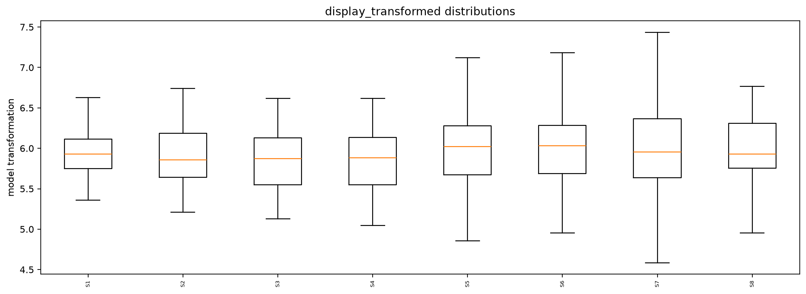](de__display_transformed_distributions.png)

First 60 sample columns displayed, up to 300 analyzed. Whiskers use the standard 1.5-IQR rule; outliers are hidden in the figure but retained in plotted data.
[Plotted data](de__display_transformed_distributions.tsv)

### display transformed pca

[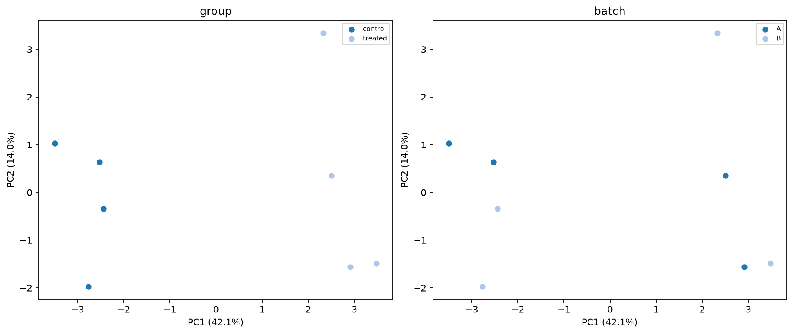](de__display_transformed_pca.png)

Unscaled PCA on at most 2,000 variable, complete features among the rows read. Missing features are omitted from PCA; samples are not imputed. Separation is descriptive, not proof of a biological or batch effect.
[Plotted data](de__display_transformed_pca.tsv)

### display transformed correlation

[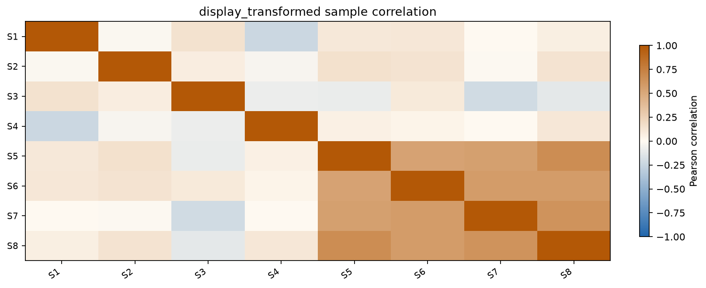](de__display_transformed_correlation.png)

Pearson correlation on complete variable features in the displayed matrix. Constant columns have undefined correlation.
[Plotted data](de__display_transformed_correlation.tsv)

### display transformed feature heatmap

[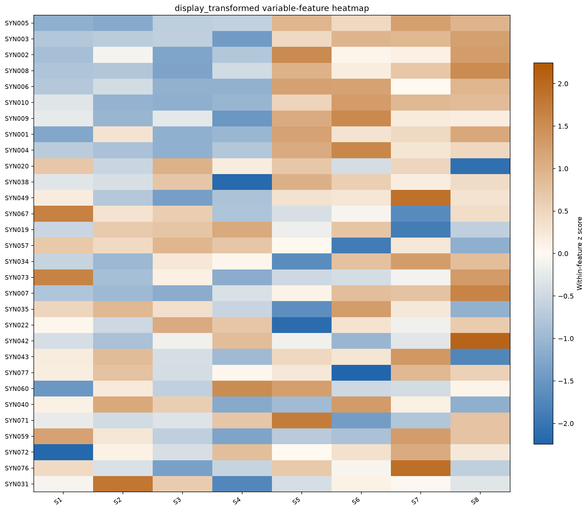](de__display_transformed_feature_heatmap.png)

Thirty highest-variance complete features among rows read; within-feature z scores are only for display and are never used as new assay measurements.
[Plotted data](de__display_transformed_feature_heatmap.tsv)

### display transformed feature values

[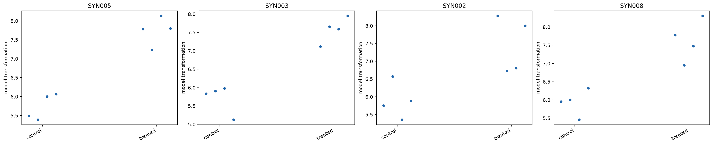](de__display_transformed_feature_values.png)

Individual measurements for four variable features, selected for visualization rather than significance. Points represent samples; repeated donor measurements require a paired statistical model.
[Plotted data](de__display_transformed_feature_values.tsv)

### library diagnostics

[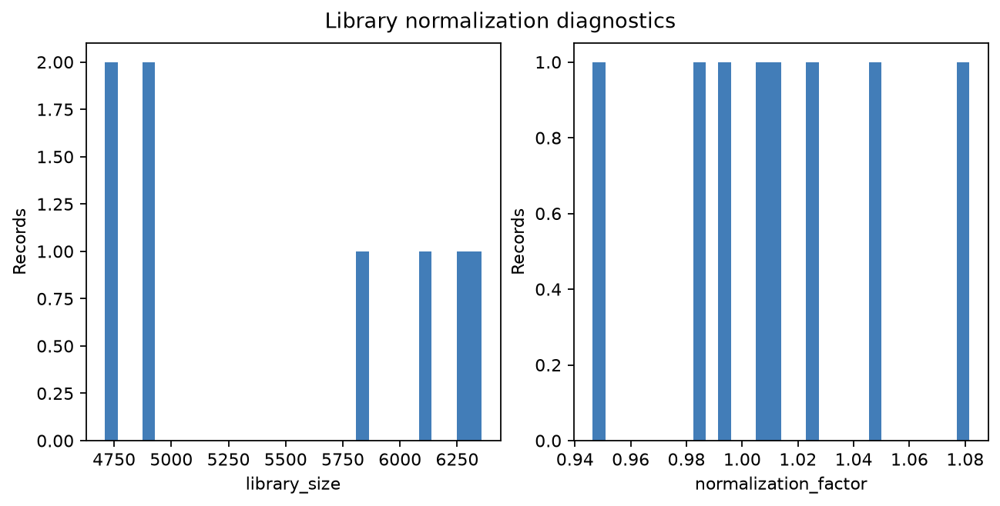](de__library_diagnostics.png)

Separate scales preserve each quantity. Histograms use the available finite values; no missing values are imputed. At most 100,000 input rows are read.
[Plotted data](de__library_diagnostics.tsv)

## dm

### all loci volcano

[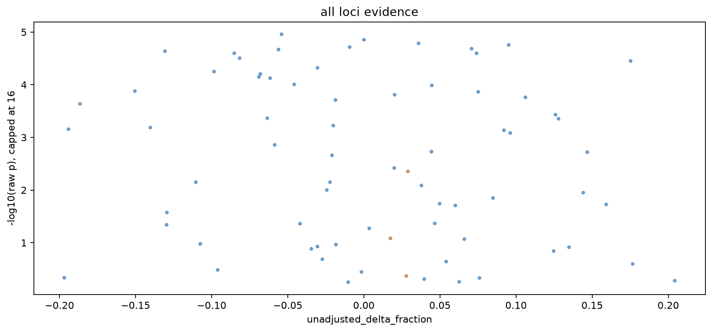](dm__all_loci_volcano.png)

Orange marks supplied adjusted p <= 0.05 for display; the analysis discovery threshold and result table remain authoritative. Effects keep their original units. No adjusted values are inferred when absent.
[Plotted data](dm__all_loci_volcano.tsv)

### all loci qq

A diagnostic comparison with uniform p-values. Alternatives, dependence, discretization and confounding can all affect this plot; it is not a calibration proof.
[Plotted data](dm__all_loci_qq.tsv)

### all loci manhattan

[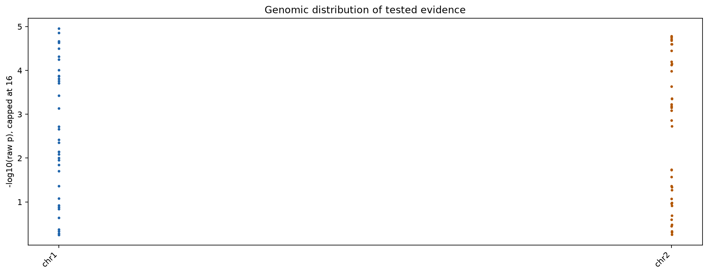](dm__all_loci_manhattan.png)

Contigs are concatenated lexically with fixed display gaps. Coordinates use the source table convention; missing sites are not plotted. No genome-wide threshold is inferred.
[Plotted data](dm__all_loci_manhattan.tsv)

### display fractions missingness

Fraction of missing values among the feature rows read. Zero values remain observed measurements.
[Plotted data](dm__display_fractions_missingness.tsv)

### display fractions distributions

First 60 sample columns displayed, up to 300 analyzed. Whiskers use the standard 1.5-IQR rule; outliers are hidden in the figure but retained in plotted data.
[Plotted data](dm__display_fractions_distributions.tsv)

### display fractions pca

Unscaled PCA on at most 2,000 variable, complete features among the rows read. Missing features are omitted from PCA; samples are not imputed. Separation is descriptive, not proof of a biological or batch effect.
[Plotted data](dm__display_fractions_pca.tsv)

### display fractions correlation

Pearson correlation on complete variable features in the displayed matrix. Constant columns have undefined correlation.
[Plotted data](dm__display_fractions_correlation.tsv)

### display fractions feature heatmap

[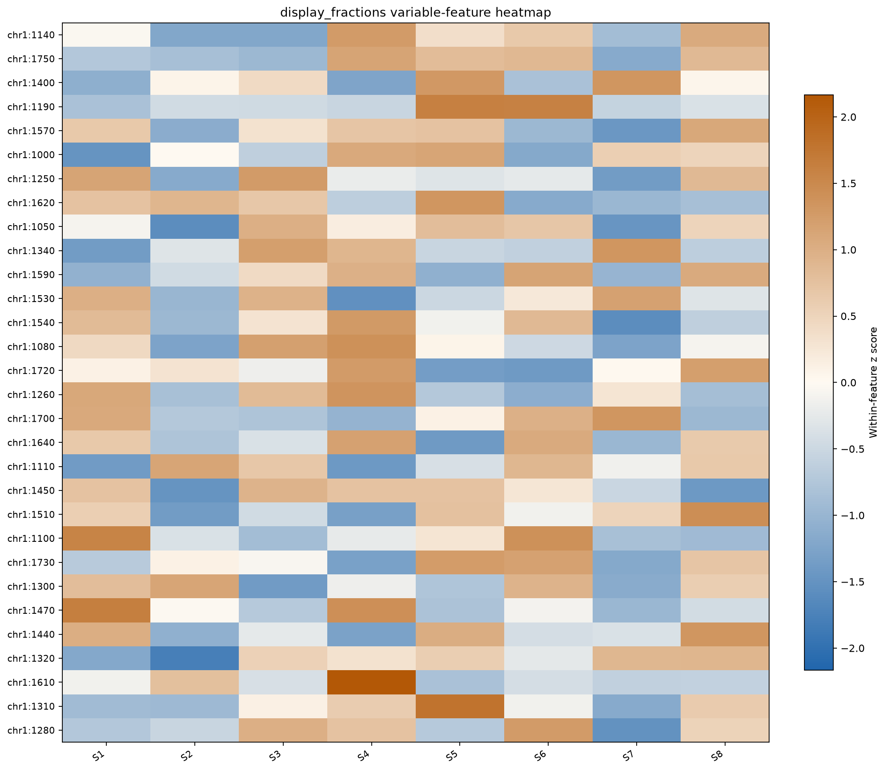](dm__display_fractions_feature_heatmap.png)

Thirty highest-variance complete features among rows read; within-feature z scores are only for display and are never used as new assay measurements.
[Plotted data](dm__display_fractions_feature_heatmap.tsv)

### display fractions feature values

Individual measurements for four variable features, selected for visualization rather than significance. Points represent samples; repeated donor measurements require a paired statistical model.
[Plotted data](dm__display_fractions_feature_values.tsv)

### methylation depth

Separate scales preserve each quantity. Histograms use the available finite values; no missing values are imputed. At most 100,000 input rows are read.
[Plotted data](dm__methylation_depth.tsv)

### methylation sample locus

First 2 kb of retained covered loci and first 12 samples. Lines connect measured positions for display; they are not interpolation, smoothing or a DMR call. Missing values remain gaps.
[Plotted data](dm__methylation_sample_locus.tsv)

## differential-compare

### method calls

Signed calls from supplied adjusted values. Gray denotes untestable; zero denotes no call. Agreement is descriptive, not an additional FDR procedure.
[Plotted data](differential-compare__method_calls.tsv)

### method intersections

[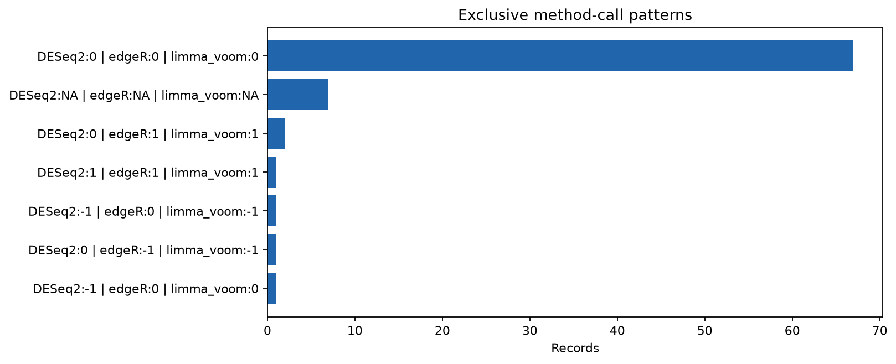](differential-compare__method_intersections.png)

Counts of records; not a significance test. Largest 25 categories shown; TSV includes all categories read.
[Plotted data](differential-compare__method_intersections.tsv)

### method effects

First six method pairs; values retain each method's effect definition. Shared direction or ranking is not proof that estimands or numerical scales are identical.
[Plotted data](differential-compare__method_effects.tsv)

### input missingness

Fraction of missing values among the feature rows read. Zero values remain observed measurements.
[Plotted data](differential-compare__input_missingness.tsv)

### input distributions

[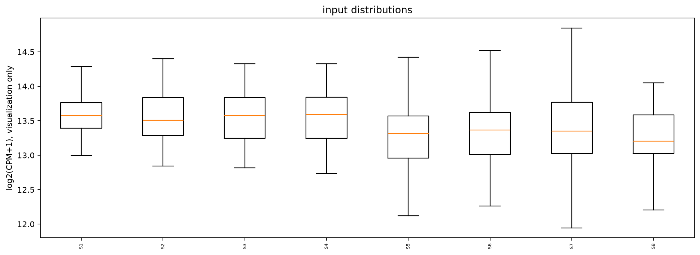](differential-compare__input_distributions.png)

First 60 sample columns displayed, up to 300 analyzed. Whiskers use the standard 1.5-IQR rule; outliers are hidden in the figure but retained in plotted data.
[Plotted data](differential-compare__input_distributions.tsv)

### input pca

Unscaled PCA on at most 2,000 variable, complete features among the rows read. Missing features are omitted from PCA; samples are not imputed. Separation is descriptive, not proof of a biological or batch effect.
[Plotted data](differential-compare__input_pca.tsv)

### input correlation

[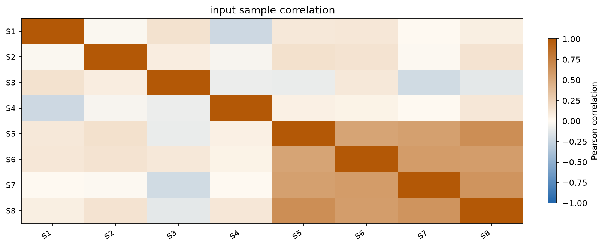](differential-compare__input_correlation.png)

Pearson correlation on complete variable features in the displayed matrix. Constant columns have undefined correlation.
[Plotted data](differential-compare__input_correlation.tsv)

### input feature heatmap

Thirty highest-variance complete features among rows read; within-feature z scores are only for display and are never used as new assay measurements.
[Plotted data](differential-compare__input_feature_heatmap.tsv)

### input feature values

Individual measurements for four variable features, selected for visualization rather than significance. Points represent samples; repeated donor measurements require a paired statistical model.
[Plotted data](differential-compare__input_feature_values.tsv)

### feature eligibility

Counts of records; not a significance test. Largest 25 categories shown; TSV includes all categories read.
[Plotted data](differential-compare__feature_eligibility.tsv)

## olink-import

### NPX missingness

[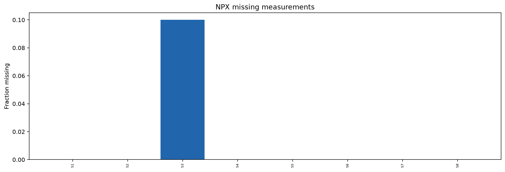](olink-import__NPX_missingness.png)

Fraction of missing values among the feature rows read. Zero values remain observed measurements.
[Plotted data](olink-import__NPX_missingness.tsv)

### NPX distributions

[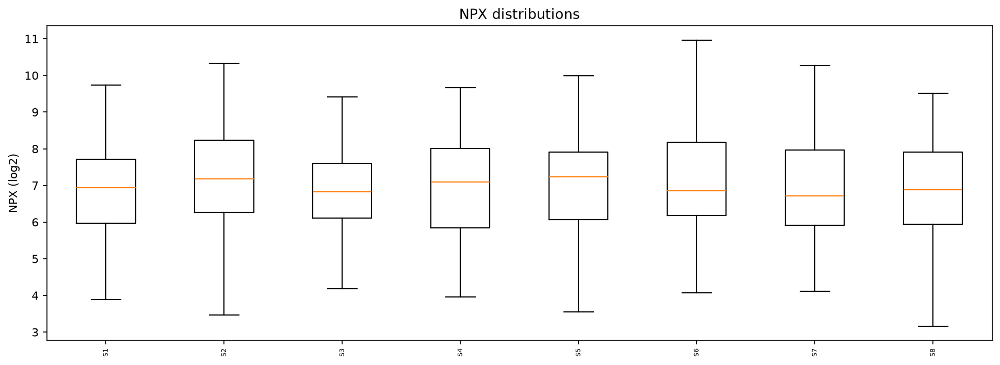](olink-import__NPX_distributions.png)

First 60 sample columns displayed, up to 300 analyzed. Whiskers use the standard 1.5-IQR rule; outliers are hidden in the figure but retained in plotted data.
[Plotted data](olink-import__NPX_distributions.tsv)

### NPX pca

Unscaled PCA on at most 2,000 variable, complete features among the rows read. Missing features are omitted from PCA; samples are not imputed. Separation is descriptive, not proof of a biological or batch effect.
[Plotted data](olink-import__NPX_pca.tsv)

### NPX correlation

Pearson correlation on complete variable features in the displayed matrix. Constant columns have undefined correlation.
[Plotted data](olink-import__NPX_correlation.tsv)

### NPX feature heatmap

[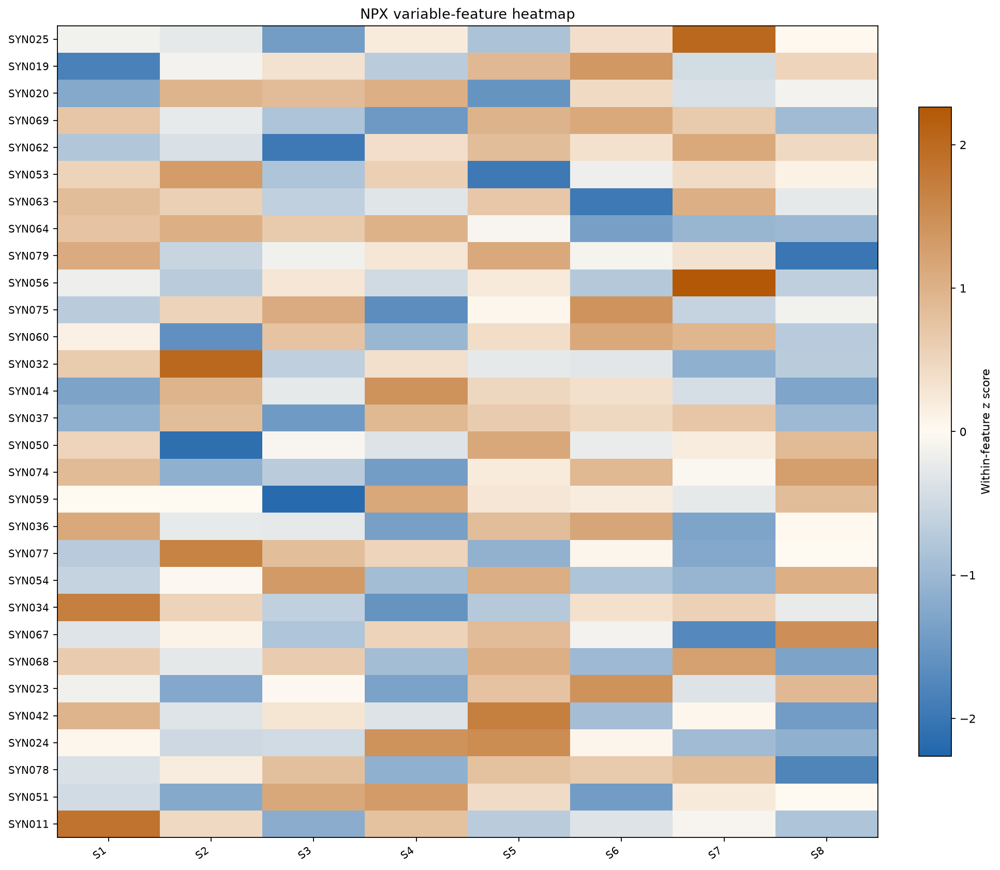](olink-import__NPX_feature_heatmap.png)

Thirty highest-variance complete features among rows read; within-feature z scores are only for display and are never used as new assay measurements.
[Plotted data](olink-import__NPX_feature_heatmap.tsv)

### NPX feature values

Individual measurements for four variable features, selected for visualization rather than significance. Points represent samples; repeated donor measurements require a paired statistical model.
[Plotted data](olink-import__NPX_feature_values.tsv)

### measurement SampleQC

[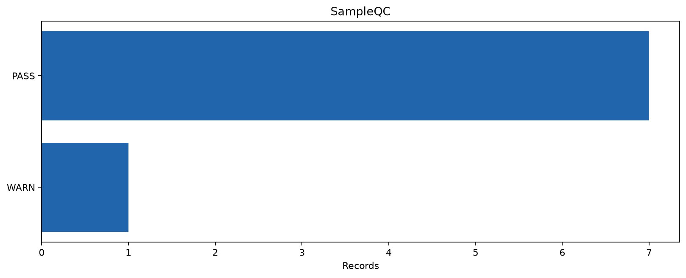](olink-import__measurement_SampleQC.png)

Counts of records; not a significance test. Largest 25 categories shown; TSV includes all categories read.
[Plotted data](olink-import__measurement_SampleQC.tsv)

### measurement AssayQC

Counts of records; not a significance test. Largest 25 categories shown; TSV includes all categories read.
[Plotted data](olink-import__measurement_AssayQC.tsv)

### measurement above LOD

[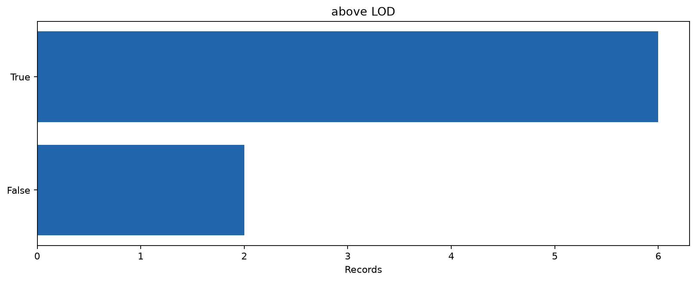](olink-import__measurement_above_LOD.png)

Counts of records; not a significance test. Largest 25 categories shown; TSV includes all categories read.
[Plotted data](olink-import__measurement_above_LOD.tsv)

### metadata association

Separate scales preserve each quantity. Histograms use the available finite values; no missing values are imputed. At most 100,000 input rows are read.
[Plotted data](olink-import__metadata_association.tsv)

### olink receipt

[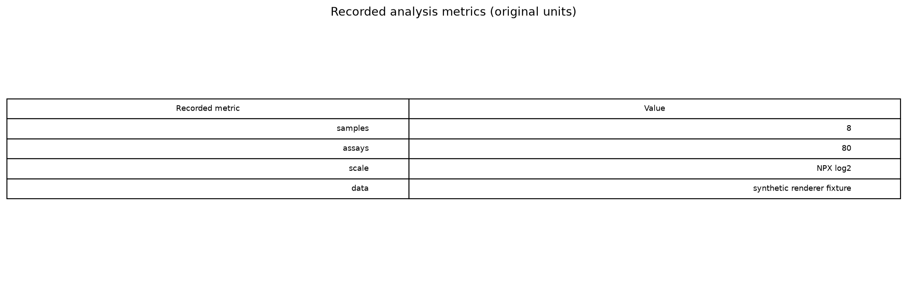](olink-import__olink_receipt.png)

Receipt values retain their individual units; they are not compared on a shared numeric axis. Up to 24 rows displayed; TSV includes all scalar entries.
[Plotted data](olink-import__olink_receipt.tsv)

## import-mods

### methylation counts

Separate scales preserve each quantity. Histograms use the available finite values; no missing values are imputed. At most 100,000 input rows are read.
[Plotted data](import-mods__methylation_counts.tsv)

### methylation contigs

[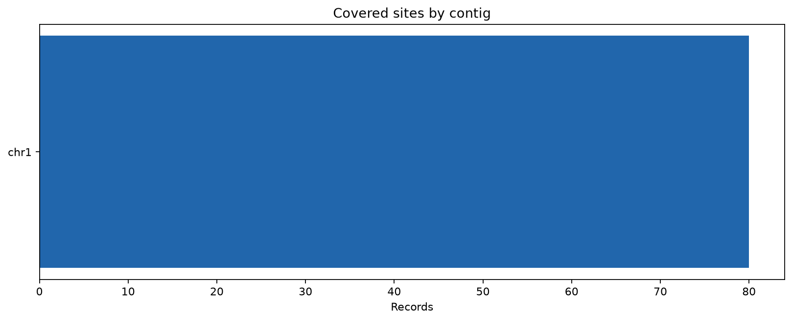](import-mods__methylation_contigs.png)

Counts apply to rows read, not whole-genome coverage when the input exceeds the report limit. Largest 25 categories shown; TSV includes all categories read.
[Plotted data](import-mods__methylation_contigs.tsv)

### methylation locus

[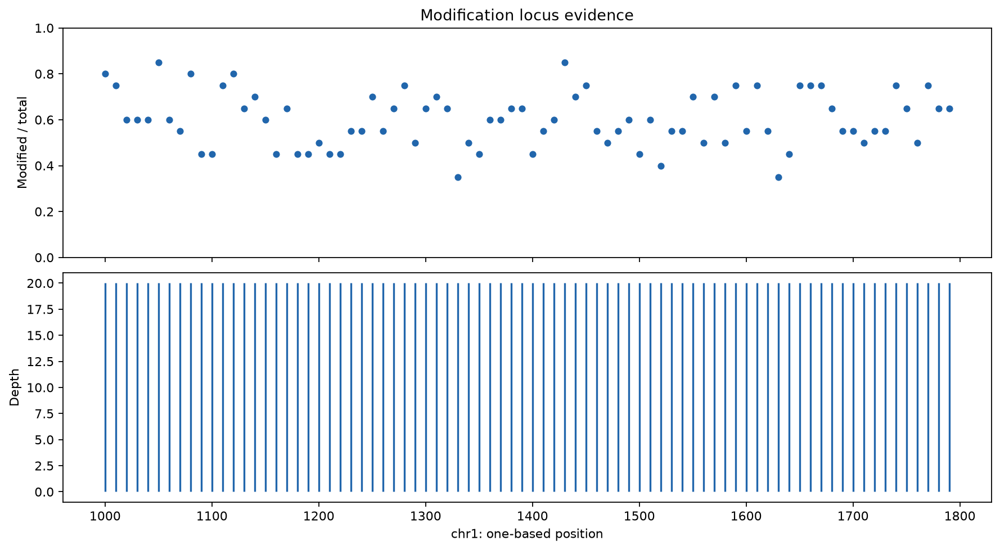](import-mods__methylation_locus.png)

Display interval chr1:1000-3000; absent sites remain gaps. The fraction uses actual X/N and does not resolve modification channels beyond the declared chemistry.
[Plotted data](import-mods__methylation_locus.tsv)

### chemistry and scope

Receipt values retain their individual units; they are not compared on a shared numeric axis. Up to 24 rows displayed; TSV includes all scalar entries.
[Plotted data](import-mods__chemistry_and_scope.tsv)

## capture-panel

### panel width

Separate scales preserve each quantity. Histograms use the available finite values; no missing values are imputed. At most 100,000 input rows are read.
[Plotted data](capture-panel__panel_width.tsv)

### panel contigs

[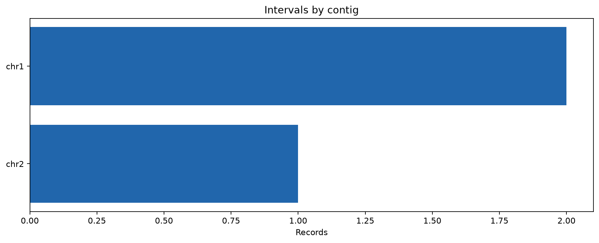](capture-panel__panel_contigs.png)

Counts of records; not a significance test. Largest 25 categories shown; TSV includes all categories read.
[Plotted data](capture-panel__panel_contigs.tsv)

### panel intervals

[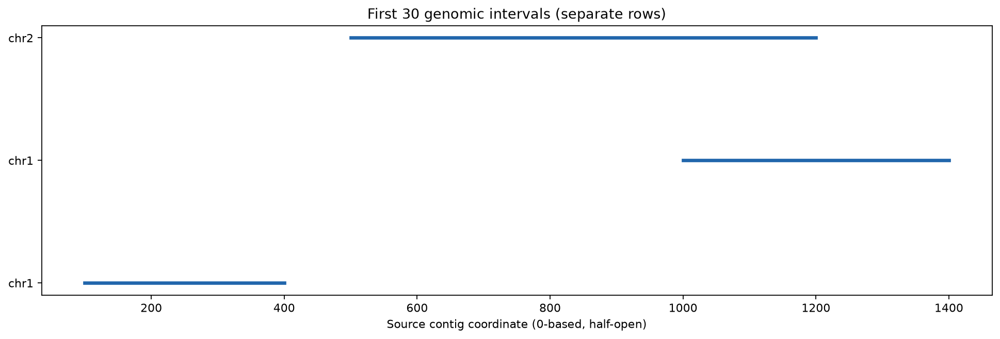](capture-panel__panel_intervals.png)

Each row is a separate interval; coordinates on different contigs are not a shared genomic location. This is interval geometry, not evidence of enhancer–gene linkage.
[Plotted data](capture-panel__panel_intervals.tsv)

### features fully on target

Counts of records; not a significance test. Largest 25 categories shown; TSV includes all categories read.
[Plotted data](capture-panel__features_fully_on_target.tsv)

### panel coverage

[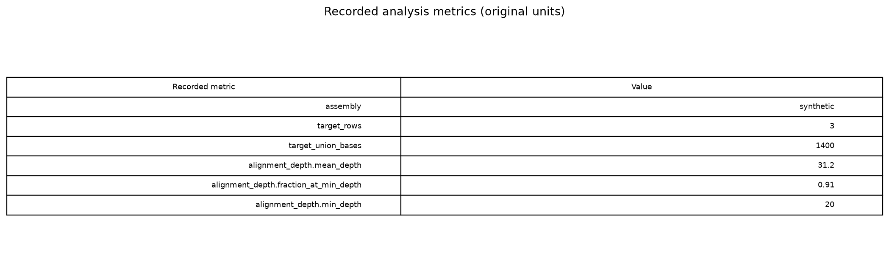](capture-panel__panel_coverage.png)

Receipt values retain their individual units; they are not compared on a shared numeric axis. Up to 24 rows displayed; TSV includes all scalar entries.
[Plotted data](capture-panel__panel_coverage.tsv)

## genomic-panel

### genomic states

[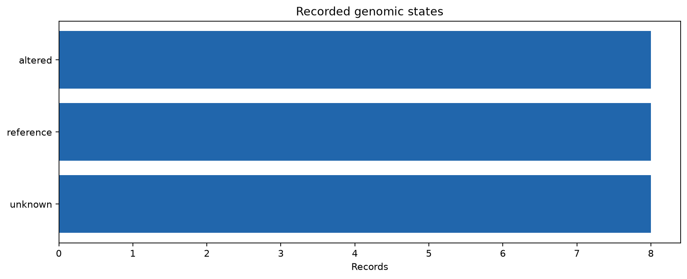](genomic-panel__genomic_states.png)

Counts of records; not a significance test. Largest 25 categories shown; TSV includes all categories read.
[Plotted data](genomic-panel__genomic_states.tsv)

### genomic oncoprint

States come from reviewed calls. Missing or unknown entries are never converted to reference; this view does not infer clinical CH status.
[Plotted data](genomic-panel__genomic_oncoprint.tsv)

## ch-screen

### CH states

Counts of records; not a significance test. Largest 25 categories shown; TSV includes all categories read.
[Plotted data](ch-screen__CH_states.tsv)

### variants alleles

Separate scales preserve each quantity. Histograms use the available finite values; no missing values are imputed. At most 100,000 input rows are read.
[Plotted data](ch-screen__variants_alleles.tsv)

### variants gene

[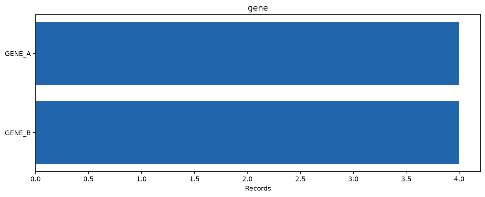](ch-screen__variants_gene.png)

Counts of records; not a significance test. Largest 25 categories shown; TSV includes all categories read.
[Plotted data](ch-screen__variants_gene.tsv)

### variants candidate

[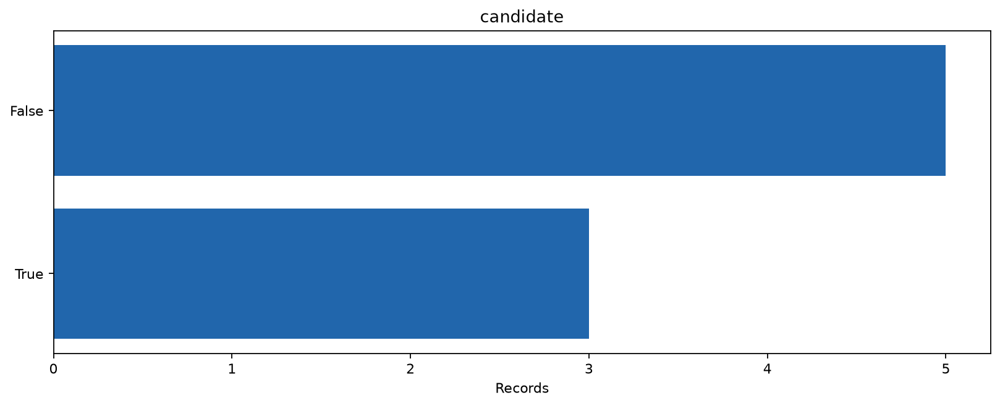](ch-screen__variants_candidate.png)

Counts of records; not a significance test. Largest 25 categories shown; TSV includes all categories read.
[Plotted data](ch-screen__variants_candidate.tsv)

### variants reasons

[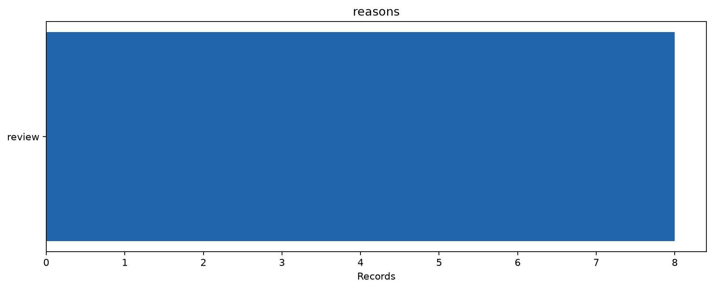](ch-screen__variants_reasons.png)

Counts of records; not a significance test. Largest 25 categories shown; TSV includes all categories read.
[Plotted data](ch-screen__variants_reasons.tsv)

## variant-annotations

### annotation clinvar status

Counts of records; not a significance test. Largest 25 categories shown; TSV includes all categories read.
[Plotted data](variant-annotations__annotation_clinvar_status.tsv)

### annotation alphamissense status

Counts of records; not a significance test. Largest 25 categories shown; TSV includes all categories read.
[Plotted data](variant-annotations__annotation_alphamissense_status.tsv)

### annotation vep status

Counts of records; not a significance test. Largest 25 categories shown; TSV includes all categories read.
[Plotted data](variant-annotations__annotation_vep_status.tsv)

## alphafold

### structure mapping status

[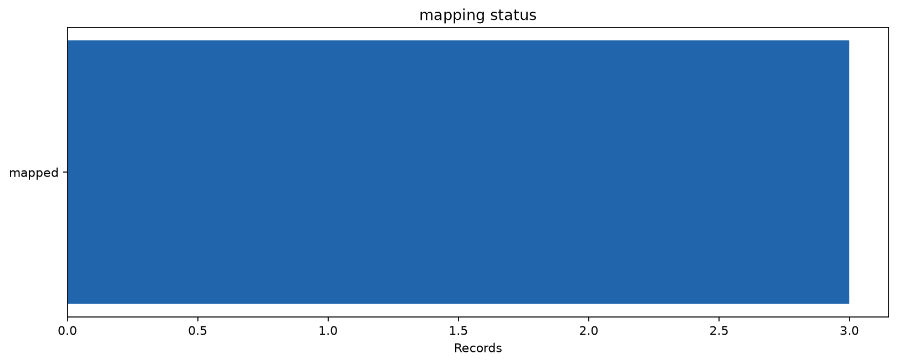](alphafold__structure_mapping_status.png)

Counts of records; not a significance test. Largest 25 categories shown; TSV includes all categories read.
[Plotted data](alphafold__structure_mapping_status.tsv)

### structure tool used

Counts of records; not a significance test. Largest 25 categories shown; TSV includes all categories read.
[Plotted data](alphafold__structure_tool_used.tsv)

### structure confidence

Separate scales preserve each quantity. Histograms use the available finite values; no missing values are imputed. At most 100,000 input rows are read.
[Plotted data](alphafold__structure_confidence.tsv)

### protein positions

Model span and mapped position from the lookup receipt, not a rendered protein structure or a pathogenicity prediction.
[Plotted data](alphafold__protein_positions.tsv)

## alphagenome

### prediction output type

[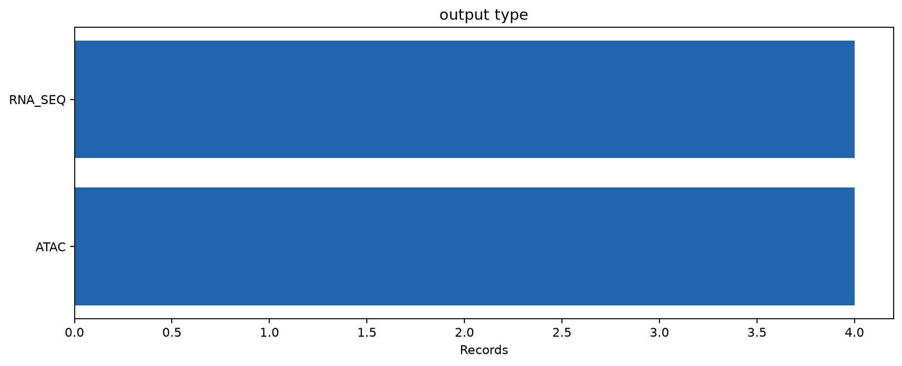](alphagenome__prediction_output_type.png)

Counts of records; not a significance test. Largest 25 categories shown; TSV includes all categories read.
[Plotted data](alphagenome__prediction_output_type.tsv)

### prediction variant id

Counts of records; not a significance test. Largest 25 categories shown; TSV includes all categories read.
[Plotted data](alphagenome__prediction_variant_id.tsv)

### regulatory predictions 1

[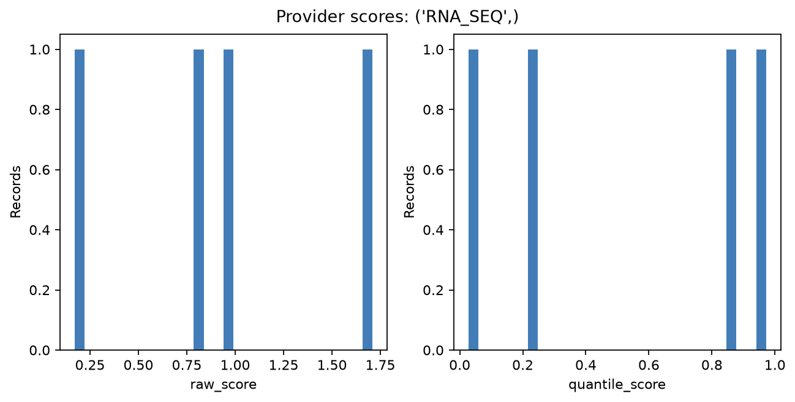](alphagenome__regulatory_predictions_1.png)

Separate scales preserve each quantity. Histograms use the available finite values; no missing values are imputed. At most 100,000 input rows are read.
[Plotted data](alphagenome__regulatory_predictions_1.tsv)

### regulatory predictions 2

[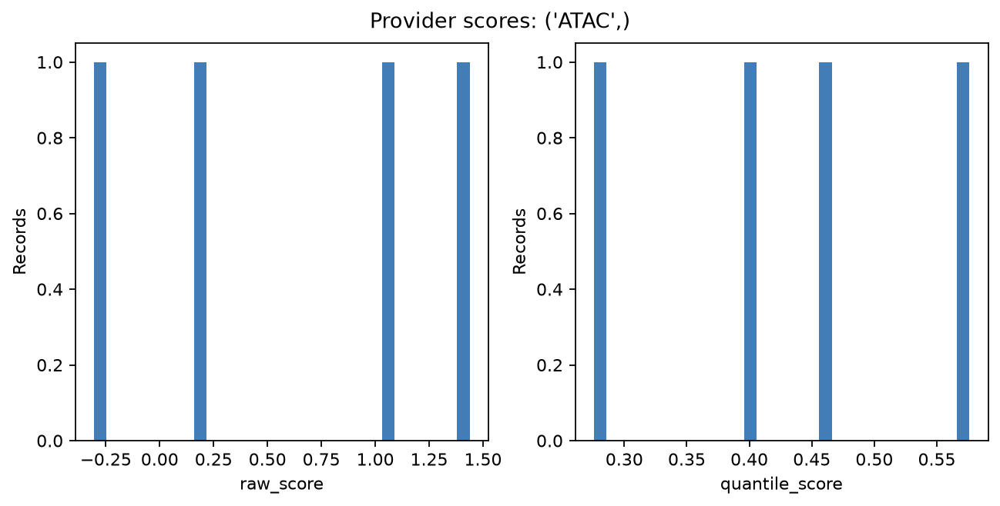](alphagenome__regulatory_predictions_2.png)

Separate scales preserve each quantity. Histograms use the available finite values; no missing values are imputed. At most 100,000 input rows are read.
[Plotted data](alphagenome__regulatory_predictions_2.tsv)

### prediction receipt

[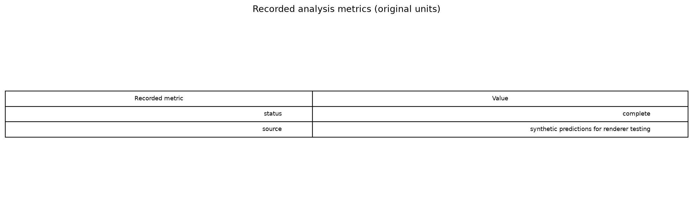](alphagenome__prediction_receipt.png)

Receipt values retain their individual units; they are not compared on a shared numeric axis. Up to 24 rows displayed; TSV includes all scalar entries.
[Plotted data](alphagenome__prediction_receipt.tsv)

## clock-panel

### score synthetic age years

[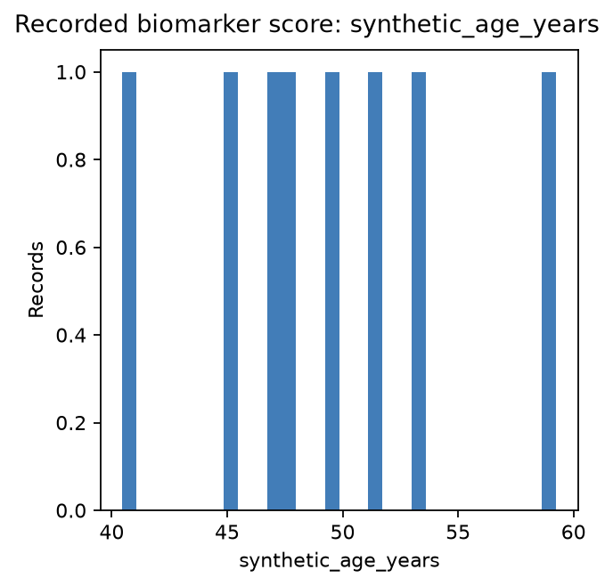](clock-panel__score_synthetic_age_years.png)

Separate scales preserve each quantity. Histograms use the available finite values; no missing values are imputed. At most 100,000 input rows are read.
[Plotted data](clock-panel__score_synthetic_age_years.tsv)

### score synthetic pace

Separate scales preserve each quantity. Histograms use the available finite values; no missing values are imputed. At most 100,000 input rows are read.
[Plotted data](clock-panel__score_synthetic_pace.tsv)

### clock correlation

Pairwise complete profiles (minimum three). Scores retain different endpoints; correlation does not make them interchangeable.
[Plotted data](clock-panel__clock_correlation.tsv)

### coverage

[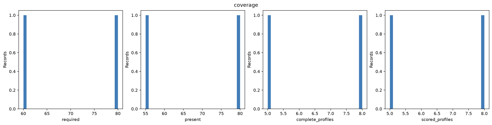](clock-panel__coverage.png)

Separate scales preserve each quantity. Histograms use the available finite values; no missing values are imputed. At most 100,000 input rows are read.
[Plotted data](clock-panel__coverage.tsv)

### clock coverage

[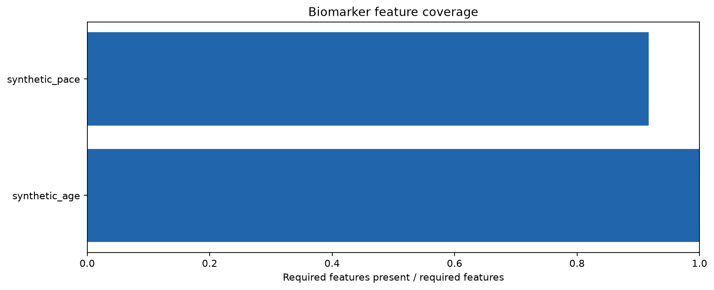](clock-panel__clock_coverage.png)

Feature presence is distinct from complete profiles and successful scoring. Coverage does not establish transferability to a new tissue or assay.
[Plotted data](clock-panel__clock_coverage.tsv)

## compare-assays

### heldout predictions

[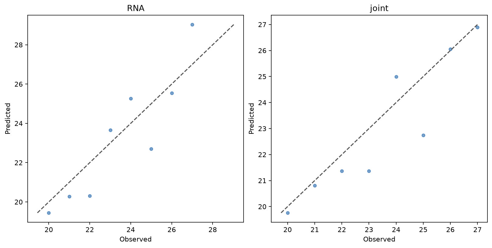](compare-assays__heldout_predictions.png)

Supplied held-out or out-of-fold predictions; the report does not train or select a model. The dashed line is identity, not a fitted calibration line.
[Plotted data](compare-assays__heldout_predictions.tsv)

### prediction residuals

[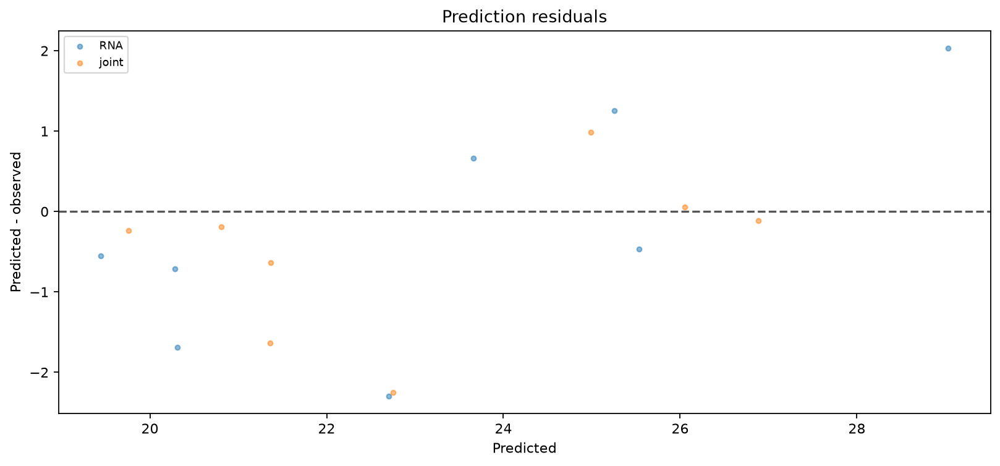](compare-assays__prediction_residuals.png)

Residual pattern by supplied model, without refitting. Units are those of the outcome.
[Plotted data](compare-assays__prediction_residuals.tsv)

### comparison intervals

[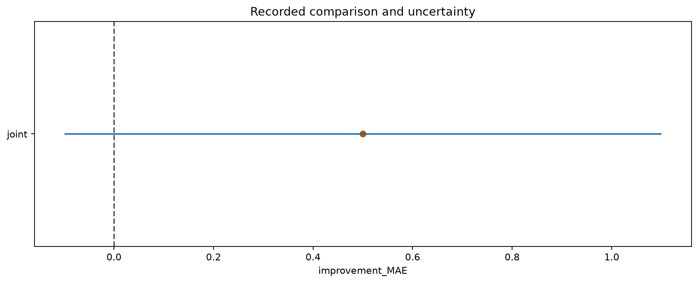](compare-assays__comparison_intervals.png)

Intervals are read from the completed analysis, not recomputed by the visualization. Their inferential scope is the scope of the source analysis.
[Plotted data](compare-assays__comparison_intervals.tsv)

## spikein-factors

### spikein counts

Separate scales preserve each quantity. Histograms use the available finite values; no missing values are imputed. At most 100,000 input rows are read.
[Plotted data](spikein-factors__spikein_counts.tsv)

### spikein exposure

Recorded target and reference counts. Reference exposure assumptions are specified by the analysis, not inferred from this correlation.
[Plotted data](spikein-factors__spikein_exposure.tsv)

## assay-audit

### audit metrics

Receipt values retain their individual units; they are not compared on a shared numeric axis. Up to 24 rows displayed; TSV includes all scalar entries.
[Plotted data](assay-audit__audit_metrics.tsv)

### assay reach

[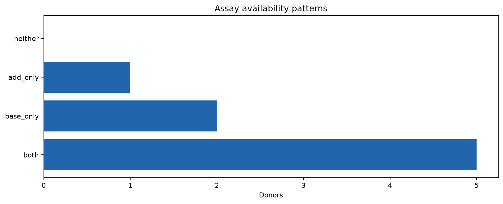](assay-audit__assay_reach.png)

Donor counts for the recorded assay-availability patterns; denominators come from this roster.
[Plotted data](assay-audit__assay_reach.tsv)

### policy intervals

[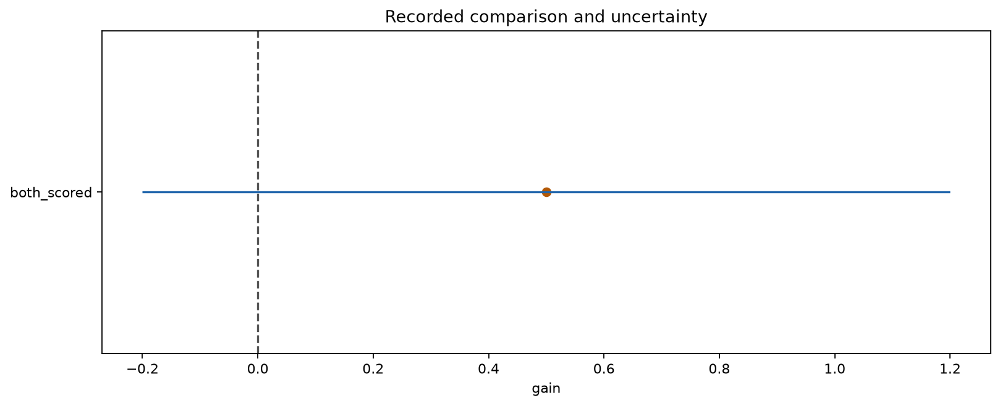](assay-audit__policy_intervals.png)

Intervals are read from the completed analysis, not recomputed by the visualization. Their inferential scope is the scope of the source analysis.
[Plotted data](assay-audit__policy_intervals.tsv)

## candidate-evidence

### audit metrics

[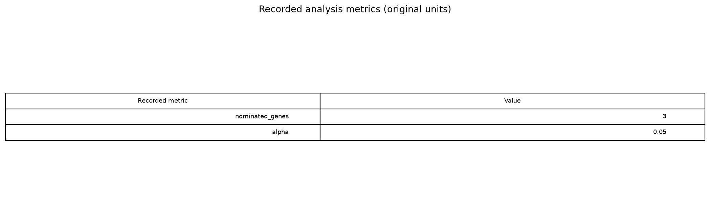](candidate-evidence__audit_metrics.png)

Receipt values retain their individual units; they are not compared on a shared numeric axis. Up to 24 rows displayed; TSV includes all scalar entries.
[Plotted data](candidate-evidence__audit_metrics.tsv)

### candidate confirmation

[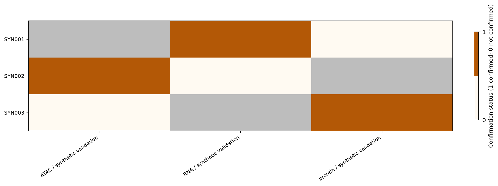](candidate-evidence__candidate_confirmation.png)

Measured endpoint confirmations remain separate from perturbation evidence. Missing evidence is not a negative experiment.
[Plotted data](candidate-evidence__candidate_confirmation.tsv)

## graft-readouts

### graft readouts

Separate scales preserve each quantity. Histograms use the available finite values; no missing values are imputed. At most 100,000 input rows are read.
[Plotted data](graft-readouts__graft_readouts.tsv)

## vep-annotate

### vep Consequence

Counts of records; not a significance test. Largest 25 categories shown; TSV includes all categories read.
[Plotted data](vep-annotate__vep_Consequence.tsv)

### vep IMPACT

[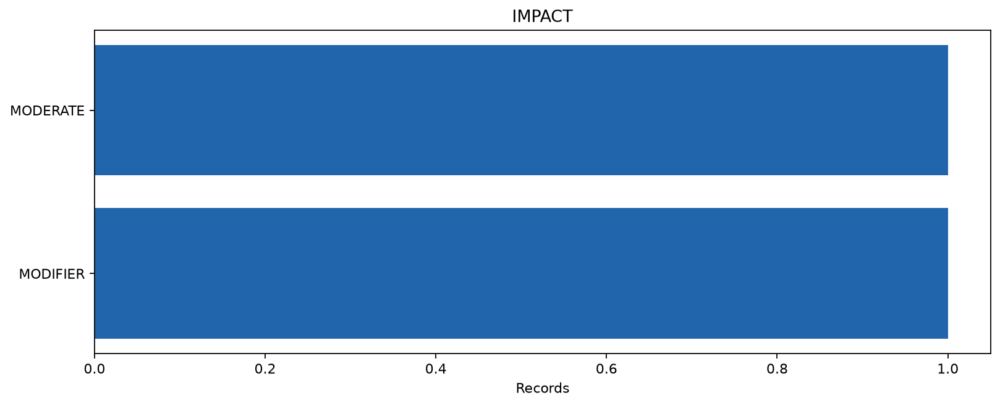](vep-annotate__vep_IMPACT.png)

Counts of records; not a significance test. Largest 25 categories shown; TSV includes all categories read.
[Plotted data](vep-annotate__vep_IMPACT.tsv)

### vep BIOTYPE

[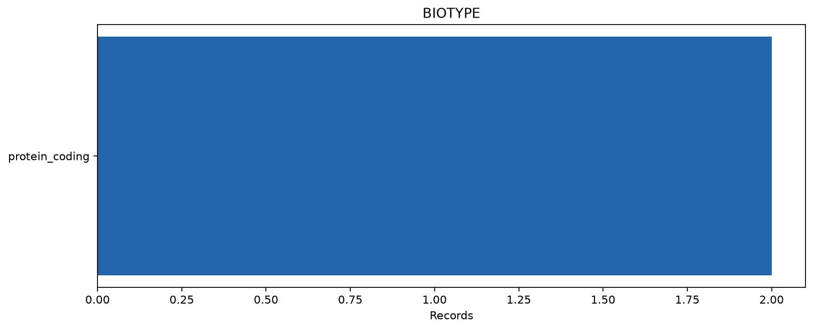](vep-annotate__vep_BIOTYPE.png)

Counts of records; not a significance test. Largest 25 categories shown; TSV includes all categories read.
[Plotted data](vep-annotate__vep_BIOTYPE.tsv)

## decision-methods

### method metrics

Receipt values retain their individual units; they are not compared on a shared numeric axis. Up to 24 rows displayed; TSV includes all scalar entries.
[Plotted data](decision-methods__method_metrics.tsv)

### assay rank matrix

[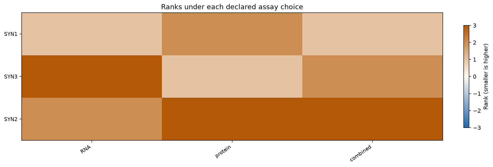](decision-methods__assay_rank_matrix.png)

Same declared feature family across the arms. Rank is descriptive; it is not a p-value or a measure of independent validation.
[Plotted data](decision-methods__assay_rank_matrix.tsv)

### rank transition 1

[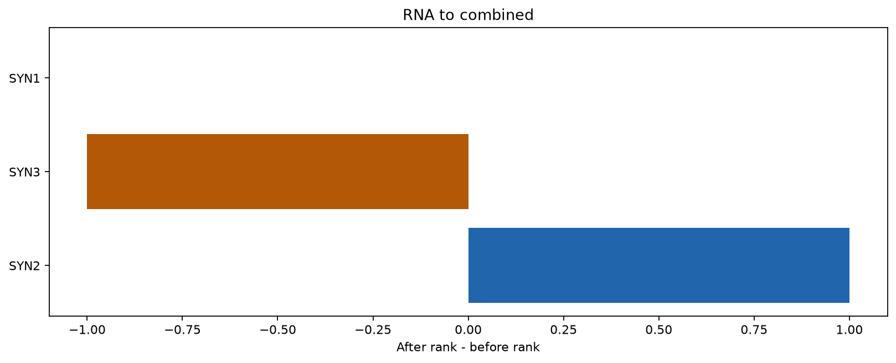](decision-methods__rank_transition_1.png)

Negative change means a better numerical rank after the specified transition; same feature family, without a causal attribution.
[Plotted data](decision-methods__rank_transition_1.tsv)

## bladder-example

### shortlist status

[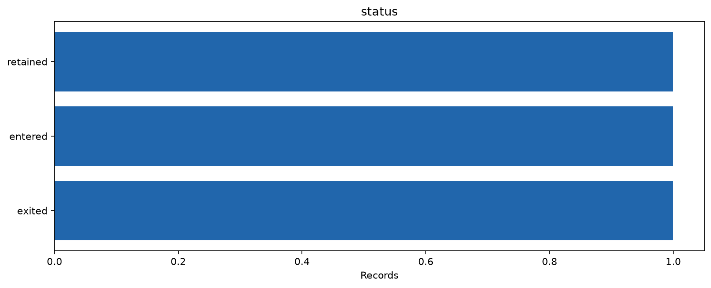](bladder-example__shortlist_status.png)

Counts of records; not a significance test. Largest 25 categories shown; TSV includes all categories read.
[Plotted data](bladder-example__shortlist_status.tsv)

### shortlist rank changes

Up to 25 genes reaching the highest rank in any arm. All arms use the source recipe definitions; changing the cohort and adding an assay remain separate comparisons.
[Plotted data](bladder-example__shortlist_rank_changes.tsv)

### recipe denominators

[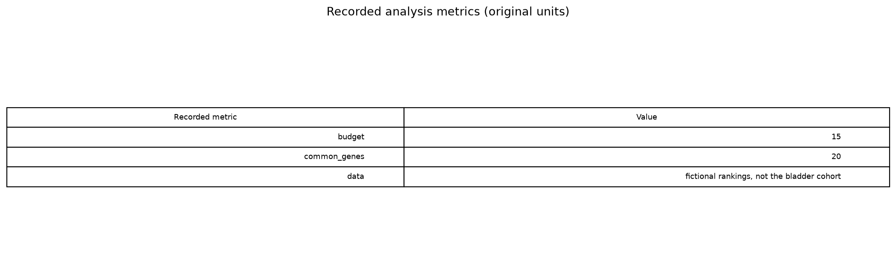](bladder-example__recipe_denominators.png)

Receipt values retain their individual units; they are not compared on a shared numeric axis. Up to 24 rows displayed; TSV includes all scalar entries.
[Plotted data](bladder-example__recipe_denominators.tsv)

## scrna

### cell qc

Separate scales preserve each quantity. Histograms use the available finite values; no missing values are imputed. At most 100,000 input rows are read.
[Plotted data](scrna__cell_qc.tsv)

### cells qc pass

Counts of records; not a significance test. Largest 25 categories shown; TSV includes all categories read.
[Plotted data](scrna__cells_qc_pass.tsv)

### cells sample

Counts of records; not a significance test. Largest 25 categories shown; TSV includes all categories read.
[Plotted data](scrna__cells_sample.tsv)

### cell complexity

Each point is a cell read from cell_qc.tsv; orange indicates a cell excluded by the recorded QC flags.
[Plotted data](scrna__cell_complexity.tsv)

### umap leiden

Uses the stored embedding; no re-clustering. First 10,000 retained cells displayed. Clusters are exploratory groups, not automatically validated cell types.
[Plotted data](scrna__umap_leiden.tsv)

### umap sample

[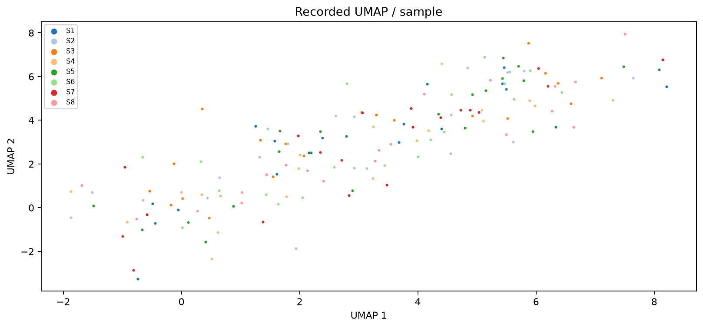](scrna__umap_sample.png)

Uses the stored embedding; no re-clustering. First 10,000 retained cells displayed. Clusters are exploratory groups, not automatically validated cell types.
[Plotted data](scrna__umap_sample.tsv)

### umap total counts

[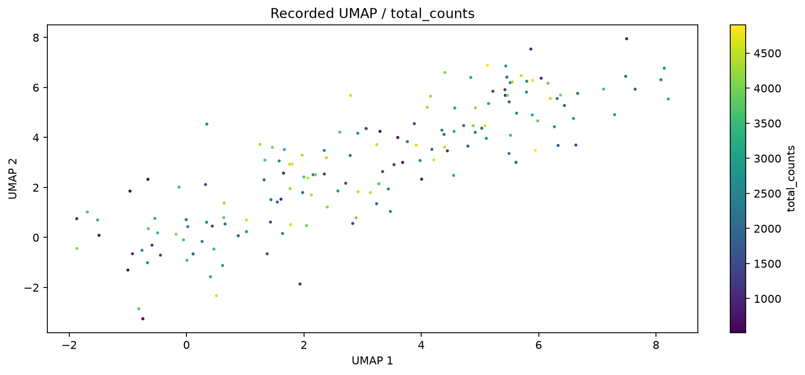](scrna__umap_total_counts.png)

Uses the stored embedding; no re-clustering. First 10,000 retained cells displayed. Clusters are exploratory groups, not automatically validated cell types.
[Plotted data](scrna__umap_total_counts.tsv)

### umap pct counts mt

Uses the stored embedding; no re-clustering. First 10,000 retained cells displayed. Clusters are exploratory groups, not automatically validated cell types.
[Plotted data](scrna__umap_pct_counts_mt.tsv)

### cell composition

Descriptive fractions among the first 10,000 retained cells. Donors, not individual cells, are the replication unit for comparative inference.
[Plotted data](scrna__cell_composition.tsv)

### cell expression dotplot

Dot area is the nonzero fraction; color is mean stored log-normalized expression. First 20 declared variable genes (or genes if flags absent). This is descriptive, not a differential marker test.
[Plotted data](scrna__cell_expression_dotplot.tsv)

## multiomic-meta

### evidence heatmap

Direction is defined by the declared orientation. Per-layer p values include feature-to-gene aggregation; color is descriptive and does not identify individually significant layers.
[Plotted data](multiomic-meta__evidence_heatmap.tsv)

### combined ranking

Orange marks selected genes; point area increases with measured layer count. Untestable rows have no point. Ranking uses raw joint p; the horizontal scale uses BY q.
[Plotted data](multiomic-meta__combined_ranking.tsv)

### concordance

Counts include all declared genes, without a significance filter. Same direction is not independent replication. Neutral denotes tied directional evidence; not-both includes unmeasured/untestable genes.
[Plotted data](multiomic-meta__concordance.tsv)

### measurement patterns

Exclusive measurement patterns preserve the distinction between absence of evidence and evidence of no association. The TSV contains every observed pattern.
[Plotted data](multiomic-meta__measurement_patterns.tsv)

### rank sensitivity

Each column removes one assay and holds r fixed. Average ranks handle ties within the same common testable gene set. Positive values indicate a better rank with that assay. This is sensitivity of supplied evidence, not measured predictive gain; eligibility losses are recorded separately.
[Plotted data](multiomic-meta__rank_sensitivity.tsv)

## pathway-compare

### pathway evidence

Top 25 by joint p when enabled, otherwise by minimum layer p for display only. Unsigned enrichment is plotted positive regardless of mechanism. All raw p and descriptive scores remain in the TSV.
[Plotted data](pathway-compare__pathway_evidence.tsv)

### pathway coverage

Gene coverage uses the assay-specific measured background. A large overlap does not itself establish enrichment.
[Plotted data](pathway-compare__pathway_coverage.tsv)

### shared gene support

Genes supplied by upstream analyses, such as leading-edge genes or ORA hits, are counted once per pathway. Empty contributions mean the upstream test did not supply gene-level support.
[Plotted data](pathway-compare__shared_gene_support.tsv)

### pathway overlap

Edges join pathways with full-GMT gene-set Jaccard overlap >= 0.25. This shows annotation redundancy, not molecular interactions or independent biological confirmations.
[Plotted data](pathway-compare__pathway_overlap.tsv)

## enrich

### pathway ranking

Point area encodes -log10(FDR q), capped at 16; position and color encode NES. Negative NES means enrichment toward the negative end of the supplied ranking.
[Plotted data](enrich__pathway_ranking.tsv)

### leading edge

Blue indicates leading-edge membership; white is absence from that leading edge, not a negative gene effect. The TSV includes all leading-edge genes in the displayed pathways.
[Plotted data](enrich__leading_edge.tsv)

### enrichment curve 1

Native fgsea plotEnrichment output. The TSV records the full ranked universe and set membership; the separate enrichment-curves.pdf retains native vector curves.
[Plotted data](enrich__enrichment_curve_1.tsv)

### enrichment curve 2

Native fgsea plotEnrichment output. The TSV records the full ranked universe and set membership; the separate enrichment-curves.pdf retains native vector curves.
[Plotted data](enrich__enrichment_curve_2.tsv)

### enrichment curve 3

Native fgsea plotEnrichment output. The TSV records the full ranked universe and set membership; the separate enrichment-curves.pdf retains native vector curves.
[Plotted data](enrich__enrichment_curve_3.tsv)

## Native fitted-model diagnostics

These are native R diagnostics from fitted models on **synthetic inputs**, generated by `python tests/integration_auto_reports.py REPO_ROOT NEW_OUTPUT` with the configured R/Bioconductor environment. They are emitted automatically by `de` or count-based `multiomic-layers`; the HTML report links the original PDF. They are separate from the plotting-only fixtures above.

### DESeq2 dispersion

[Native vector PDF](de-deseq2-dispersion.pdf)

### edgeR quasi-likelihood dispersion

[Native vector PDF](de-edger-ql-dispersion.pdf)

### limma-voom mean-variance trend

[Native vector PDF](multiomic-layers-voom.pdf)
