# KilnBio visualization gallery

Every example below uses **fictional data**. These are the same renderers called automatically by the listed commands. They demonstrate output design, not biological validation. Each image links to its full resolution; each TSV contains the plotted values.

Run `python examples/visualizations/make_gallery.py NEW_OUTPUT --with-enrichment` in the singlecell environment to regenerate these examples and their offline HTML/PDF reports. For real data, run the analysis command normally. See [automatic reports](../VISUALIZATIONS.md) for required inputs, command aliases, output locations, display limits, and native upstream reports.

The matrix-QC designs shown for `de` and Olink are also used by `multiomic-layers`, `featurecounts` and donor-level `pseudobulk`. Method-comparison panels also serve `method-agreement`; modification panels also serve completed `ont` outputs; score panels serve compatible methylation and other assay clocks. A new fitted model is never inferred from a similar-looking chart.

## Browse by analysis

[`de`](#de) · [`dm`](#dm) · [`differential-compare`](#differential-compare) · [`olink-import`](#olink-import) · [`import-mods`](#import-mods) · [`capture-panel`](#capture-panel) · [`genomic-panel`](#genomic-panel) · [`ch-screen`](#ch-screen) · [`variant-annotations`](#variant-annotations) · [`alphafold`](#alphafold) · [`alphagenome`](#alphagenome) · [`clock-panel`](#clock-panel) · [`compare-assays`](#compare-assays) · [`spikein-factors`](#spikein-factors) · [`assay-audit`](#assay-audit) · [`candidate-evidence`](#candidate-evidence) · [`graft-readouts`](#graft-readouts) · [`vep-annotate`](#vep-annotate) · [`decision-methods`](#decision-methods) · [`bladder-example`](#bladder-example) · [`scrna`](#scrna) · [`multiomic-meta`](#multiomic-meta) · [`pathway-compare`](#pathway-compare) · [`enrich`](#enrich)

## de

### Effect size and statistical evidence

**Why it matters.** A small p-value and a large biological effect answer different questions. Seeing both helps avoid selecting candidates on only one criterion.

[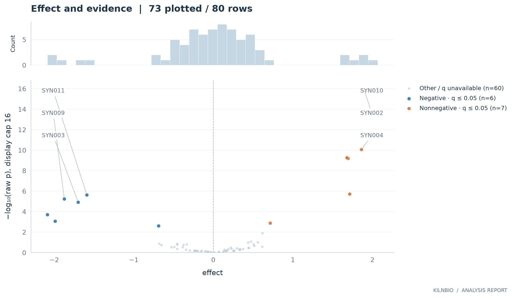](de__all_features_volcano.png)

**How to read it.** Horizontal position is the reported effect; height is raw-p evidence. Colored points meet the stated adjusted-p display threshold. Labels identify a small set for inspection, not a new selection rule.

Method and display details

Blue/orange mark negative/nonnegative effects with supplied adjusted p <= 0.05; gray includes other points and unavailable q. The marginal histogram shows the plotted effect distribution. At most three qualifying features per direction are labeled by raw p then identifier. No horizontal FDR line is inferred on the raw-p axis. The analysis discovery threshold and result table remain authoritative.

[Full-size figure](de__all_features_volcano.png) · [Plotted values (TSV)](de__all_features_volcano.tsv)

### Abundance and effect size

**Why it matters.** Low-abundance features often have different precision from well-measured features.

[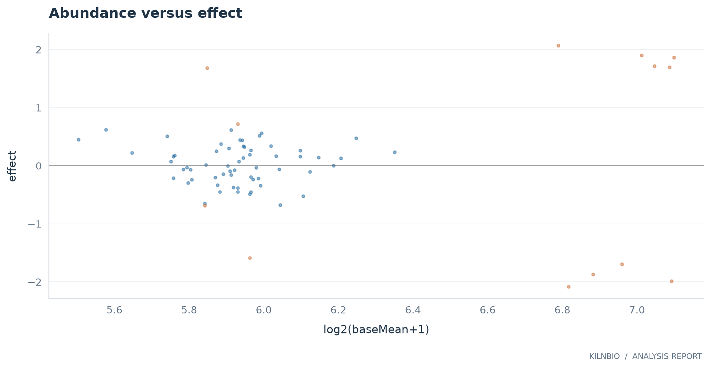](de__all_features_ma.png)

**How to read it.** Check whether the largest effects concentrate among weakly measured features before choosing them for follow-up.

Method and display details

MA/MD-style descriptive diagnostic; original model values are not altered.

[Full-size figure](de__all_features_ma.png) · [Plotted values (TSV)](de__all_features_ma.tsv)

### P-value distribution check

**Why it matters.** Unexpected p-value behavior can reveal a mismatch between the model and the data, as well as real associations.

[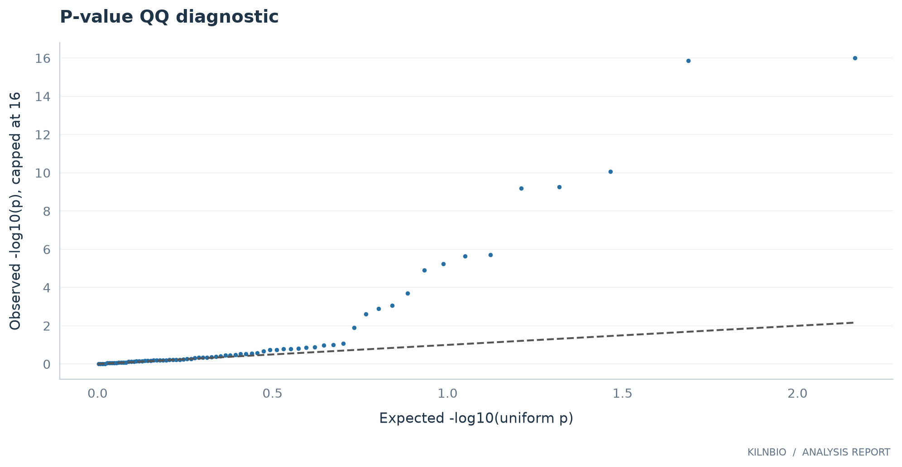](de__all_features_qq.png)

**How to read it.** Compare points with the reference line. Departures deserve investigation alongside design and QC; this chart alone cannot identify their cause.

Method and display details

A diagnostic comparison with uniform p-values. Alternatives, dependence, discretization and confounding can all affect this plot; it is not a calibration proof.

[Full-size figure](de__all_features_qq.png) · [Plotted values (TSV)](de__all_features_qq.tsv)

### What was actually measurable?

**Why it matters.** Apparent improvements can arise when an analysis quietly changes which samples or features it includes.

[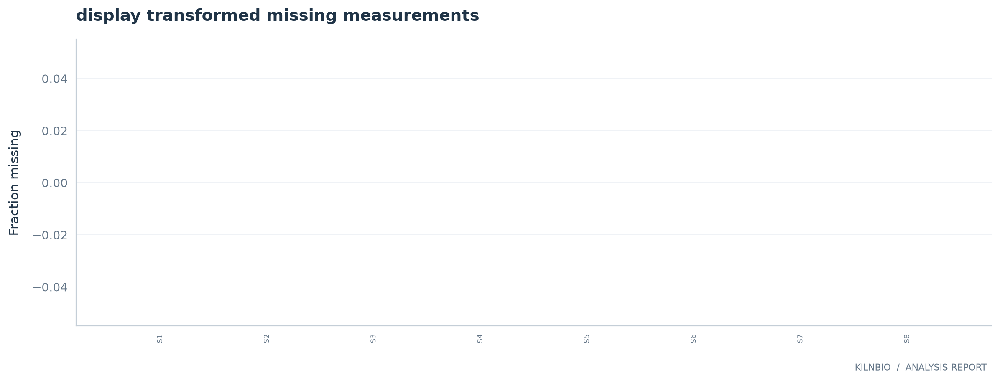](de__display_transformed_missingness.png)

**How to read it.** Check the measured denominator and missing categories before comparing results. Coverage and eligibility are different from positive biological evidence.

Method and display details

Fraction of missing values among the feature rows read. Zero values remain observed measurements.

[Full-size figure](de__display_transformed_missingness.png) · [Plotted values (TSV)](de__display_transformed_missingness.tsv)

### Display transformed distributions

**Why it matters.** Measurement quality and distribution determine which comparisons the data can support.

**How to read it.** Inspect the units, counts and unusual values alongside the source QC flags. This display summarizes the recorded measurements without changing the analysis.

Method and display details

First 60 sample columns displayed, up to 300 analyzed. Whiskers use the standard 1.5-IQR rule; outliers are hidden in the figure but retained in plotted data.

[Full-size figure](de__display_transformed_distributions.png) · [Plotted values (TSV)](de__display_transformed_distributions.tsv)

### Sample relationships

**Why it matters.** Unexpected sample groupings or unusually dissimilar samples can change the interpretation of a downstream comparison.

**How to read it.** Compare patterns with sample condition and batch metadata. Investigate outliers rather than removing them solely because of this plot.

Method and display details

Unscaled PCA on at most 2,000 variable, complete features among the rows read. Missing features are omitted from PCA; samples are not imputed. Separation is descriptive, not proof of a biological or batch effect.

[Full-size figure](de__display_transformed_pca.png) · [Plotted values (TSV)](de__display_transformed_pca.tsv)

### Sample relationships

**Why it matters.** Unexpected sample groupings or unusually dissimilar samples can change the interpretation of a downstream comparison.

**How to read it.** Compare patterns with sample condition and batch metadata. Investigate outliers rather than removing them solely because of this plot.

Method and display details

Pearson correlation on complete variable features in the displayed matrix. Constant columns have undefined correlation.

[Full-size figure](de__display_transformed_correlation.png) · [Plotted values (TSV)](de__display_transformed_correlation.tsv)

### Patterns in measured features

**Why it matters.** Individual measurements reveal variation that is hidden by a summary statistic.

**How to read it.** Inspect variation within groups as well as between them. Display-selected features and row-standardized colors do not introduce new statistical tests.

Method and display details

Thirty highest-variance complete features among rows read; within-feature z scores are only for display and are never used as new assay measurements.

[Full-size figure](de__display_transformed_feature_heatmap.png) · [Plotted values (TSV)](de__display_transformed_feature_heatmap.tsv)

### Patterns in measured features

**Why it matters.** Individual measurements reveal variation that is hidden by a summary statistic.

**How to read it.** Inspect variation within groups as well as between them. Display-selected features and row-standardized colors do not introduce new statistical tests.

Method and display details

Individual measurements for four variable features, selected for visualization rather than significance. Points represent samples; repeated donor measurements require a paired statistical model.

[Full-size figure](de__display_transformed_feature_values.png) · [Plotted values (TSV)](de__display_transformed_feature_values.tsv)

### Library diagnostics

**Why it matters.** Measurement quality and distribution determine which comparisons the data can support.

**How to read it.** Inspect the units, counts and unusual values alongside the source QC flags. This display summarizes the recorded measurements without changing the analysis.

Method and display details

Separate scales preserve each quantity. Histograms use the available finite values; no missing values are imputed. At most 100,000 input rows are read.

[Full-size figure](de__library_diagnostics.png) · [Plotted values (TSV)](de__library_diagnostics.tsv)

## dm

### Effect size and statistical evidence

**Why it matters.** A small p-value and a large biological effect answer different questions. Seeing both helps avoid selecting candidates on only one criterion.

**How to read it.** Horizontal position is the reported effect; height is raw-p evidence. Colored points meet the stated adjusted-p display threshold. Labels identify a small set for inspection, not a new selection rule.

Method and display details

Blue/orange mark negative/nonnegative effects with supplied adjusted p <= 0.05; gray includes other points and unavailable q. The marginal histogram shows the plotted effect distribution. At most three qualifying features per direction are labeled by raw p then identifier. No horizontal FDR line is inferred on the raw-p axis. The analysis discovery threshold and result table remain authoritative.

[Full-size figure](dm__all_loci_volcano.png) · [Plotted values (TSV)](dm__all_loci_volcano.tsv)

### P-value distribution check

**Why it matters.** Unexpected p-value behavior can reveal a mismatch between the model and the data, as well as real associations.

**How to read it.** Compare points with the reference line. Departures deserve investigation alongside design and QC; this chart alone cannot identify their cause.

Method and display details

A diagnostic comparison with uniform p-values. Alternatives, dependence, discretization and confounding can all affect this plot; it is not a calibration proof.

[Full-size figure](dm__all_loci_qq.png) · [Plotted values (TSV)](dm__all_loci_qq.tsv)

### Where the evidence occurs

**Why it matters.** Genomic context helps distinguish an isolated observation from a regional pattern and connects results to measurable loci.

**How to read it.** Inspect coordinates and local coverage together. Gaps mean no displayed measurement; they do not establish absence of an effect.

Method and display details

Observed contig spans are concatenated lexically with gaps equal to 3.5% of their summed spans (minimum one coordinate unit); unobserved contig prefixes are trimmed for display. Coordinates in the TSV retain the source convention. This is not a full-genome coverage map. No genome-wide threshold is inferred.

[Full-size figure](dm__all_loci_manhattan.png) · [Plotted values (TSV)](dm__all_loci_manhattan.tsv)

### What was actually measurable?

**Why it matters.** Apparent improvements can arise when an analysis quietly changes which samples or features it includes.

[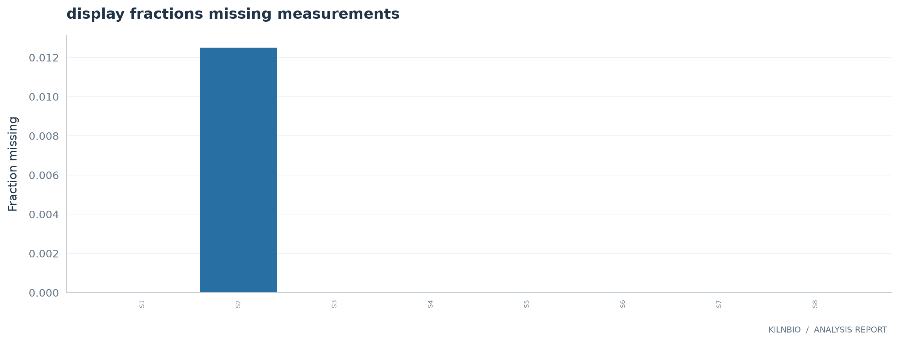](dm__display_fractions_missingness.png)

**How to read it.** Check the measured denominator and missing categories before comparing results. Coverage and eligibility are different from positive biological evidence.

Method and display details

Fraction of missing values among the feature rows read. Zero values remain observed measurements.

[Full-size figure](dm__display_fractions_missingness.png) · [Plotted values (TSV)](dm__display_fractions_missingness.tsv)

### Display fractions distributions

**Why it matters.** Measurement quality and distribution determine which comparisons the data can support.

[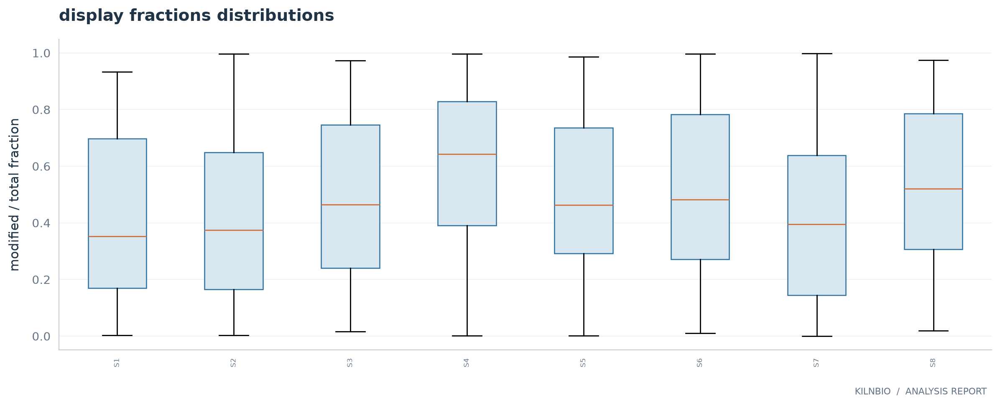](dm__display_fractions_distributions.png)

**How to read it.** Inspect the units, counts and unusual values alongside the source QC flags. This display summarizes the recorded measurements without changing the analysis.

Method and display details

First 60 sample columns displayed, up to 300 analyzed. Whiskers use the standard 1.5-IQR rule; outliers are hidden in the figure but retained in plotted data.

[Full-size figure](dm__display_fractions_distributions.png) · [Plotted values (TSV)](dm__display_fractions_distributions.tsv)

### Sample relationships

**Why it matters.** Unexpected sample groupings or unusually dissimilar samples can change the interpretation of a downstream comparison.

[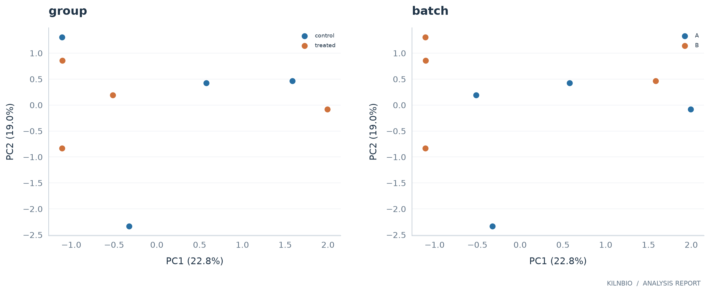](dm__display_fractions_pca.png)

**How to read it.** Compare patterns with sample condition and batch metadata. Investigate outliers rather than removing them solely because of this plot.

Method and display details

Unscaled PCA on at most 2,000 variable, complete features among the rows read. Missing features are omitted from PCA; samples are not imputed. Separation is descriptive, not proof of a biological or batch effect.

[Full-size figure](dm__display_fractions_pca.png) · [Plotted values (TSV)](dm__display_fractions_pca.tsv)

### Sample relationships

**Why it matters.** Unexpected sample groupings or unusually dissimilar samples can change the interpretation of a downstream comparison.

[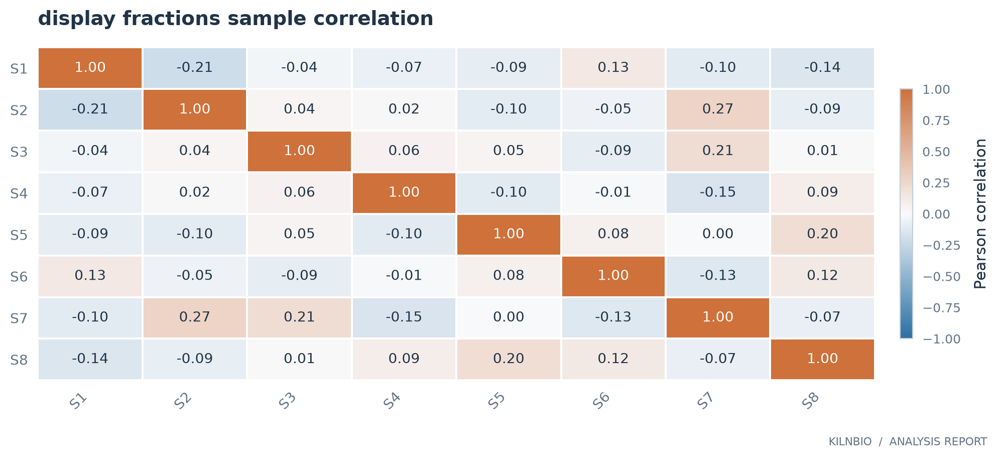](dm__display_fractions_correlation.png)

**How to read it.** Compare patterns with sample condition and batch metadata. Investigate outliers rather than removing them solely because of this plot.

Method and display details

Pearson correlation on complete variable features in the displayed matrix. Constant columns have undefined correlation.

[Full-size figure](dm__display_fractions_correlation.png) · [Plotted values (TSV)](dm__display_fractions_correlation.tsv)

### Patterns in measured features

**Why it matters.** Individual measurements reveal variation that is hidden by a summary statistic.

**How to read it.** Inspect variation within groups as well as between them. Display-selected features and row-standardized colors do not introduce new statistical tests.

Method and display details

Thirty highest-variance complete features among rows read; within-feature z scores are only for display and are never used as new assay measurements.

[Full-size figure](dm__display_fractions_feature_heatmap.png) · [Plotted values (TSV)](dm__display_fractions_feature_heatmap.tsv)

### Patterns in measured features

**Why it matters.** Individual measurements reveal variation that is hidden by a summary statistic.

[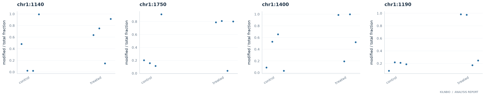](dm__display_fractions_feature_values.png)

**How to read it.** Inspect variation within groups as well as between them. Display-selected features and row-standardized colors do not introduce new statistical tests.

Method and display details

Individual measurements for four variable features, selected for visualization rather than significance. Points represent samples; repeated donor measurements require a paired statistical model.

[Full-size figure](dm__display_fractions_feature_values.png) · [Plotted values (TSV)](dm__display_fractions_feature_values.tsv)

### Methylation depth

**Why it matters.** Measurement quality and distribution determine which comparisons the data can support.

[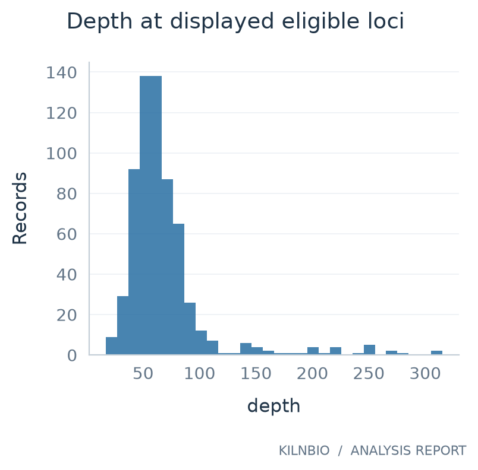](dm__methylation_depth.png)

**How to read it.** Inspect the units, counts and unusual values alongside the source QC flags. This display summarizes the recorded measurements without changing the analysis.

Method and display details

Separate scales preserve each quantity. Histograms use the available finite values; no missing values are imputed. At most 100,000 input rows are read.

[Full-size figure](dm__methylation_depth.png) · [Plotted values (TSV)](dm__methylation_depth.tsv)

### Where the evidence occurs

**Why it matters.** Genomic context helps distinguish an isolated observation from a regional pattern and connects results to measurable loci.

[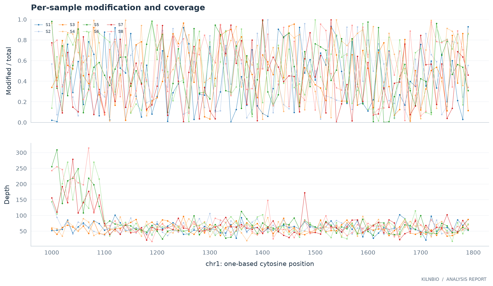](dm__methylation_sample_locus.png)

**How to read it.** Inspect coordinates and local coverage together. Gaps mean no displayed measurement; they do not establish absence of an effect.

Method and display details

First 2 kb of retained covered loci and first 12 samples. Lines connect measured positions for display; they are not interpolation, smoothing or a DMR call. Missing values remain gaps.

[Full-size figure](dm__methylation_sample_locus.png) · [Plotted values (TSV)](dm__methylation_sample_locus.tsv)

## differential-compare

### Sensitivity to analysis method

**Why it matters.** Different methods can produce different candidate lists from the same measurements.

[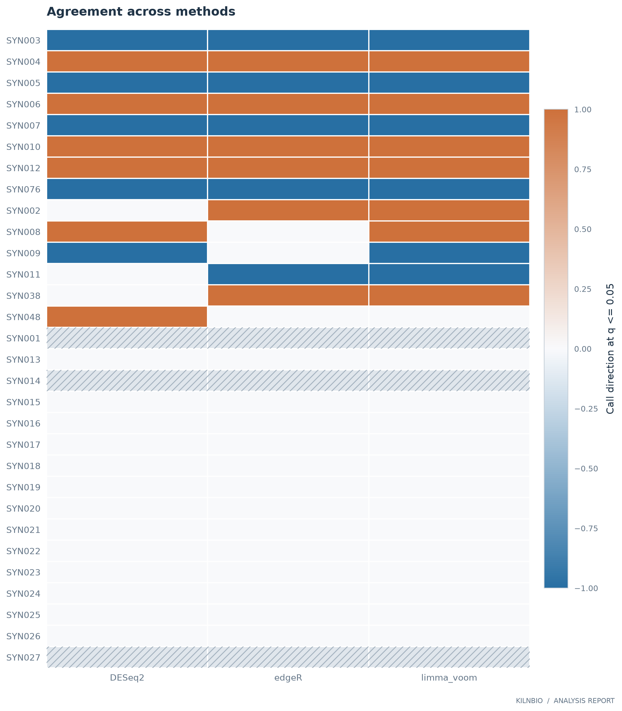](differential-compare__method_calls.png)

**How to read it.** Look for stable directions and calls, then inspect disagreements. Method agreement is a robustness description, not an extra significance test.

Method and display details

Signed calls from supplied adjusted values. Gray denotes untestable; zero denotes no call. Agreement is descriptive, not an additional FDR procedure.

[Full-size figure](differential-compare__method_calls.png) · [Plotted values (TSV)](differential-compare__method_calls.tsv)

### Sensitivity to analysis method

**Why it matters.** Different methods can produce different candidate lists from the same measurements.

**How to read it.** Look for stable directions and calls, then inspect disagreements. Method agreement is a robustness description, not an extra significance test.

Method and display details

Each row is an exclusive combination of signed calls at the declared adjusted-p threshold. Zero is no call, hatched gray is untestable; up to 25 most frequent patterns are shown. The TSV contains all combinations. This is descriptive robustness, not a new FDR procedure.

[Full-size figure](differential-compare__method_intersections.png) · [Plotted values (TSV)](differential-compare__method_intersections.tsv)

### Sensitivity to analysis method

**Why it matters.** Different methods can produce different candidate lists from the same measurements.

[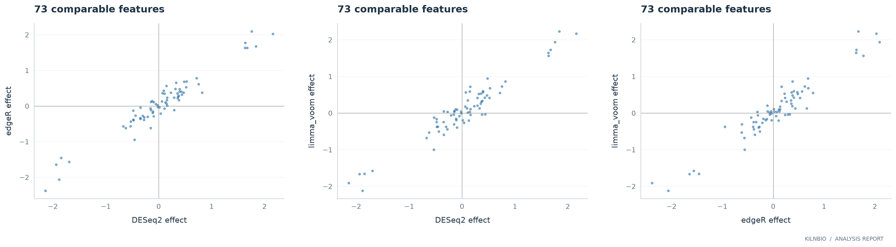](differential-compare__method_effects.png)

**How to read it.** Look for stable directions and calls, then inspect disagreements. Method agreement is a robustness description, not an extra significance test.

Method and display details

First six method pairs; values retain each method's effect definition. Shared direction or ranking is not proof that estimands or numerical scales are identical.

[Full-size figure](differential-compare__method_effects.png) · [Plotted values (TSV)](differential-compare__method_effects.tsv)

### What was actually measurable?

**Why it matters.** Apparent improvements can arise when an analysis quietly changes which samples or features it includes.

[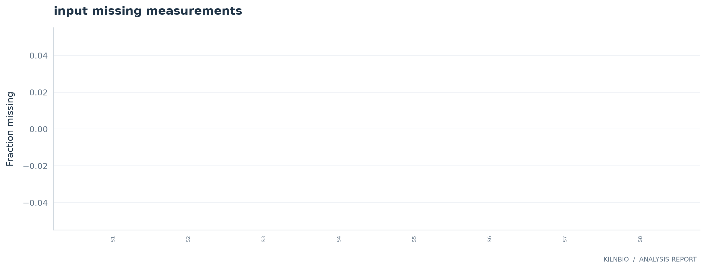](differential-compare__input_missingness.png)

**How to read it.** Check the measured denominator and missing categories before comparing results. Coverage and eligibility are different from positive biological evidence.

Method and display details

Fraction of missing values among the feature rows read. Zero values remain observed measurements.

[Full-size figure](differential-compare__input_missingness.png) · [Plotted values (TSV)](differential-compare__input_missingness.tsv)

### Input distributions

**Why it matters.** Measurement quality and distribution determine which comparisons the data can support.

**How to read it.** Inspect the units, counts and unusual values alongside the source QC flags. This display summarizes the recorded measurements without changing the analysis.

Method and display details

First 60 sample columns displayed, up to 300 analyzed. Whiskers use the standard 1.5-IQR rule; outliers are hidden in the figure but retained in plotted data.

[Full-size figure](differential-compare__input_distributions.png) · [Plotted values (TSV)](differential-compare__input_distributions.tsv)

### Sample relationships

**Why it matters.** Unexpected sample groupings or unusually dissimilar samples can change the interpretation of a downstream comparison.

[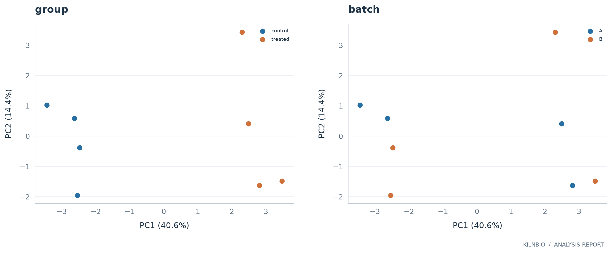](differential-compare__input_pca.png)

**How to read it.** Compare patterns with sample condition and batch metadata. Investigate outliers rather than removing them solely because of this plot.

Method and display details

Unscaled PCA on at most 2,000 variable, complete features among the rows read. Missing features are omitted from PCA; samples are not imputed. Separation is descriptive, not proof of a biological or batch effect.

[Full-size figure](differential-compare__input_pca.png) · [Plotted values (TSV)](differential-compare__input_pca.tsv)

### Sample relationships

**Why it matters.** Unexpected sample groupings or unusually dissimilar samples can change the interpretation of a downstream comparison.

**How to read it.** Compare patterns with sample condition and batch metadata. Investigate outliers rather than removing them solely because of this plot.

Method and display details

Pearson correlation on complete variable features in the displayed matrix. Constant columns have undefined correlation.

[Full-size figure](differential-compare__input_correlation.png) · [Plotted values (TSV)](differential-compare__input_correlation.tsv)

### Patterns in measured features

**Why it matters.** Individual measurements reveal variation that is hidden by a summary statistic.

[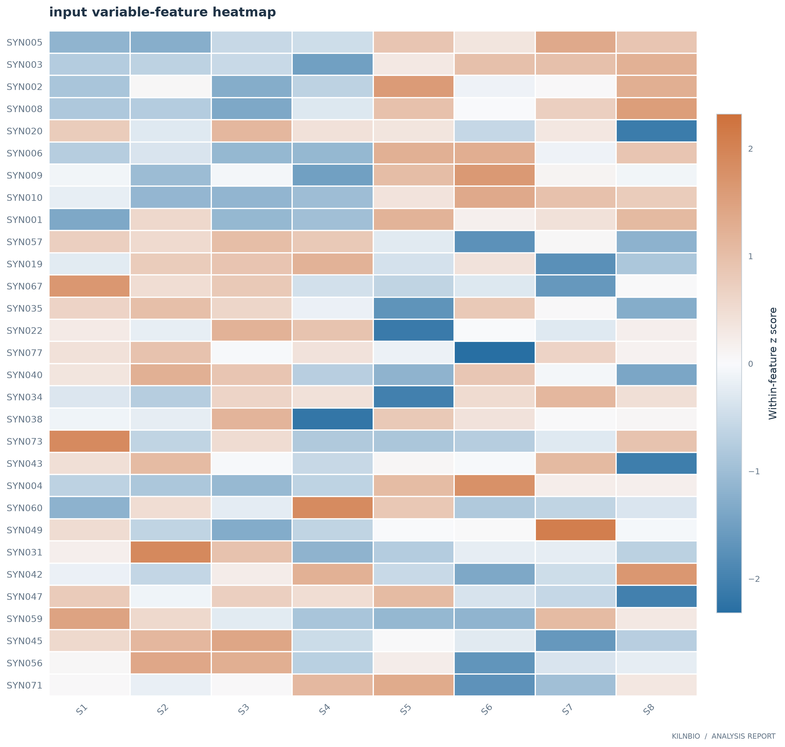](differential-compare__input_feature_heatmap.png)

**How to read it.** Inspect variation within groups as well as between them. Display-selected features and row-standardized colors do not introduce new statistical tests.

Method and display details

Thirty highest-variance complete features among rows read; within-feature z scores are only for display and are never used as new assay measurements.

[Full-size figure](differential-compare__input_feature_heatmap.png) · [Plotted values (TSV)](differential-compare__input_feature_heatmap.tsv)

### Patterns in measured features

**Why it matters.** Individual measurements reveal variation that is hidden by a summary statistic.

[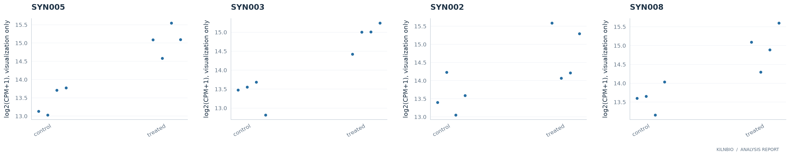](differential-compare__input_feature_values.png)

**How to read it.** Inspect variation within groups as well as between them. Display-selected features and row-standardized colors do not introduce new statistical tests.

Method and display details

Individual measurements for four variable features, selected for visualization rather than significance. Points represent samples; repeated donor measurements require a paired statistical model.

[Full-size figure](differential-compare__input_feature_values.png) · [Plotted values (TSV)](differential-compare__input_feature_values.tsv)

### What was actually measurable?

**Why it matters.** Apparent improvements can arise when an analysis quietly changes which samples or features it includes.

[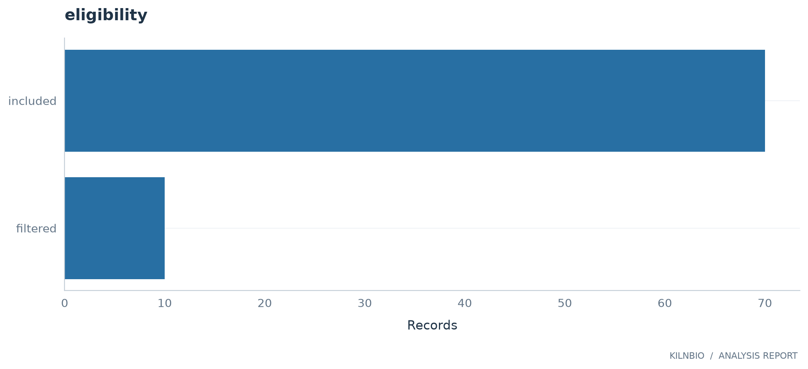](differential-compare__feature_eligibility.png)

**How to read it.** Check the measured denominator and missing categories before comparing results. Coverage and eligibility are different from positive biological evidence.

Method and display details

Counts of records; not a significance test. Largest 25 categories shown; TSV includes all categories read.

[Full-size figure](differential-compare__feature_eligibility.png) · [Plotted values (TSV)](differential-compare__feature_eligibility.tsv)

## olink-import

### What was actually measurable?

**Why it matters.** Apparent improvements can arise when an analysis quietly changes which samples or features it includes.

**How to read it.** Check the measured denominator and missing categories before comparing results. Coverage and eligibility are different from positive biological evidence.

Method and display details

Fraction of missing values among the feature rows read. Zero values remain observed measurements.

[Full-size figure](olink-import__NPX_missingness.png) · [Plotted values (TSV)](olink-import__NPX_missingness.tsv)

### Npx distributions

**Why it matters.** Measurement quality and distribution determine which comparisons the data can support.

**How to read it.** Inspect the units, counts and unusual values alongside the source QC flags. This display summarizes the recorded measurements without changing the analysis.

Method and display details

First 60 sample columns displayed, up to 300 analyzed. Whiskers use the standard 1.5-IQR rule; outliers are hidden in the figure but retained in plotted data.

[Full-size figure](olink-import__NPX_distributions.png) · [Plotted values (TSV)](olink-import__NPX_distributions.tsv)

### Sample relationships

**Why it matters.** Unexpected sample groupings or unusually dissimilar samples can change the interpretation of a downstream comparison.

[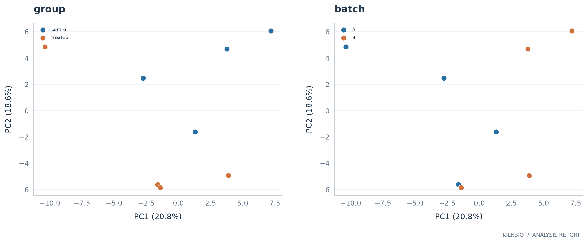](olink-import__NPX_pca.png)

**How to read it.** Compare patterns with sample condition and batch metadata. Investigate outliers rather than removing them solely because of this plot.

Method and display details

Unscaled PCA on at most 2,000 variable, complete features among the rows read. Missing features are omitted from PCA; samples are not imputed. Separation is descriptive, not proof of a biological or batch effect.

[Full-size figure](olink-import__NPX_pca.png) · [Plotted values (TSV)](olink-import__NPX_pca.tsv)

### Sample relationships

**Why it matters.** Unexpected sample groupings or unusually dissimilar samples can change the interpretation of a downstream comparison.

[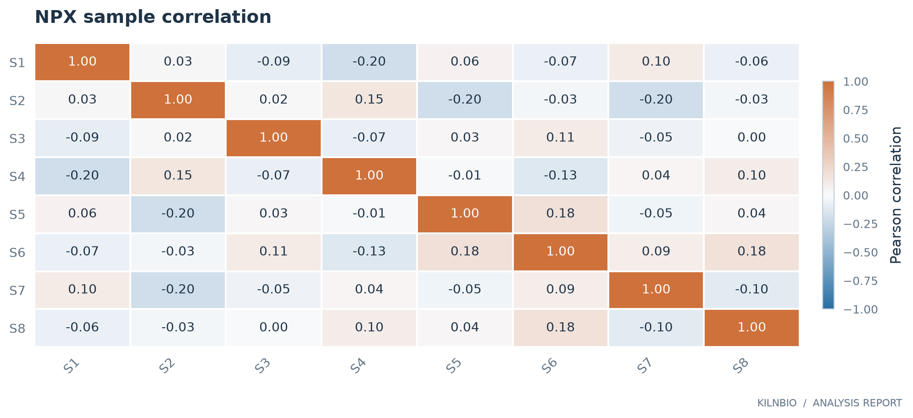](olink-import__NPX_correlation.png)

**How to read it.** Compare patterns with sample condition and batch metadata. Investigate outliers rather than removing them solely because of this plot.

Method and display details

Pearson correlation on complete variable features in the displayed matrix. Constant columns have undefined correlation.

[Full-size figure](olink-import__NPX_correlation.png) · [Plotted values (TSV)](olink-import__NPX_correlation.tsv)

### Patterns in measured features

**Why it matters.** Individual measurements reveal variation that is hidden by a summary statistic.

**How to read it.** Inspect variation within groups as well as between them. Display-selected features and row-standardized colors do not introduce new statistical tests.

Method and display details

Thirty highest-variance complete features among rows read; within-feature z scores are only for display and are never used as new assay measurements.

[Full-size figure](olink-import__NPX_feature_heatmap.png) · [Plotted values (TSV)](olink-import__NPX_feature_heatmap.tsv)

### Patterns in measured features

**Why it matters.** Individual measurements reveal variation that is hidden by a summary statistic.

[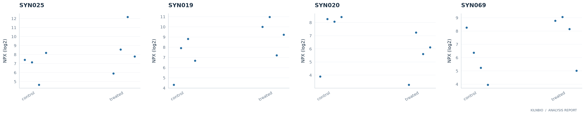](olink-import__NPX_feature_values.png)

**How to read it.** Inspect variation within groups as well as between them. Display-selected features and row-standardized colors do not introduce new statistical tests.

Method and display details

Individual measurements for four variable features, selected for visualization rather than significance. Points represent samples; repeated donor measurements require a paired statistical model.

[Full-size figure](olink-import__NPX_feature_values.png) · [Plotted values (TSV)](olink-import__NPX_feature_values.tsv)

### Measurement sampleqc

**Why it matters.** Measurement quality and distribution determine which comparisons the data can support.

**How to read it.** Inspect the units, counts and unusual values alongside the source QC flags. This display summarizes the recorded measurements without changing the analysis.

Method and display details

Counts of records; not a significance test. Largest 25 categories shown; TSV includes all categories read.

[Full-size figure](olink-import__measurement_SampleQC.png) · [Plotted values (TSV)](olink-import__measurement_SampleQC.tsv)

### Measurement assayqc

**Why it matters.** Measurement quality and distribution determine which comparisons the data can support.

[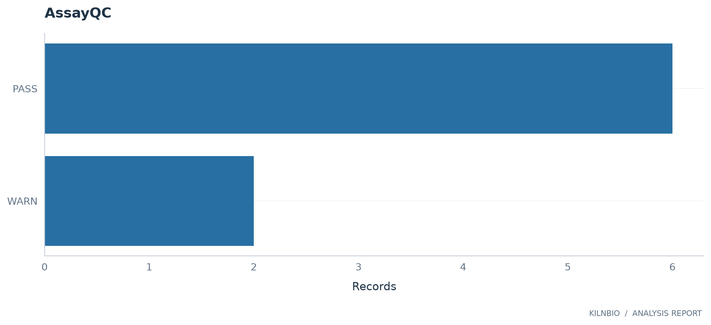](olink-import__measurement_AssayQC.png)

**How to read it.** Inspect the units, counts and unusual values alongside the source QC flags. This display summarizes the recorded measurements without changing the analysis.

Method and display details

Counts of records; not a significance test. Largest 25 categories shown; TSV includes all categories read.

[Full-size figure](olink-import__measurement_AssayQC.png) · [Plotted values (TSV)](olink-import__measurement_AssayQC.tsv)

### Measurement above lod

**Why it matters.** Measurement quality and distribution determine which comparisons the data can support.

**How to read it.** Inspect the units, counts and unusual values alongside the source QC flags. This display summarizes the recorded measurements without changing the analysis.

Method and display details

Counts of records; not a significance test. Largest 25 categories shown; TSV includes all categories read.

[Full-size figure](olink-import__measurement_above_LOD.png) · [Plotted values (TSV)](olink-import__measurement_above_LOD.tsv)

### Relationship between study variables

**Why it matters.** When condition and technical variables overlap, their effects can be difficult or impossible to separate statistically.

[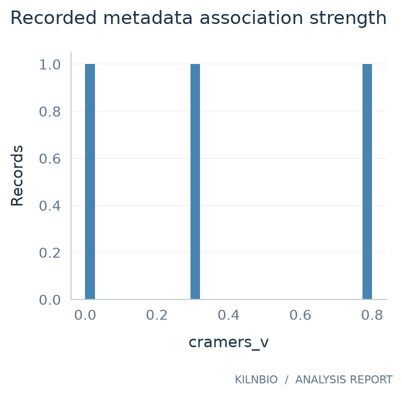](olink-import__metadata_association.png)

**How to read it.** Inspect the recorded association between metadata variables before fitting a model. This is a design diagnostic; it does not remove confounding.

Method and display details

Separate scales preserve each quantity. Histograms use the available finite values; no missing values are imputed. At most 100,000 input rows are read.

[Full-size figure](olink-import__metadata_association.png) · [Plotted values (TSV)](olink-import__metadata_association.tsv)

### Analysis scope and recorded quantities

**Why it matters.** Reliable interpretation depends on knowing what ran and which denominators and units were recorded.

**How to read it.** Use these recorded quantities to trace the analysis. Values with different units remain separate rather than sharing an arbitrary numeric scale.

Method and display details

Receipt values retain their individual units; they are not compared on a shared numeric axis. Up to 24 rows displayed; TSV includes all scalar entries.

[Full-size figure](olink-import__olink_receipt.png) · [Plotted values (TSV)](olink-import__olink_receipt.tsv)

## import-mods

### Methylation counts

**Why it matters.** Measurement quality and distribution determine which comparisons the data can support.

[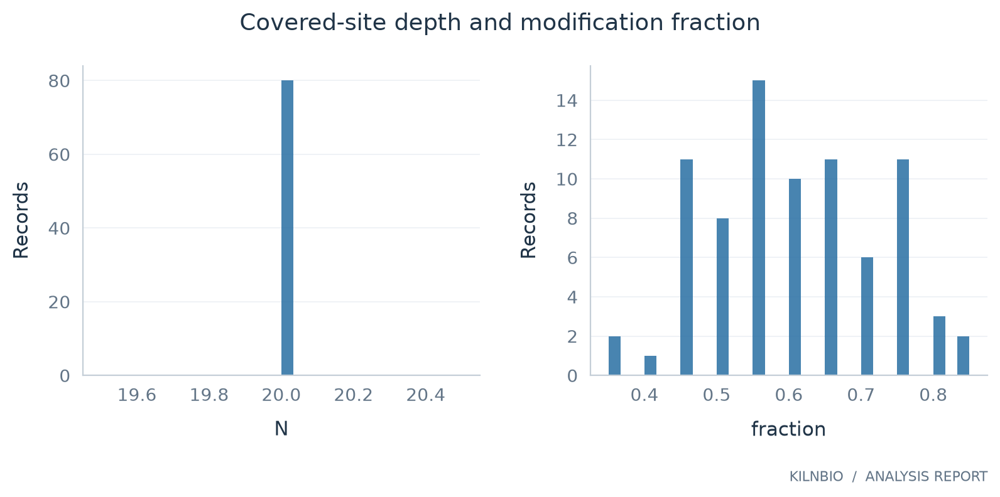](import-mods__methylation_counts.png)

**How to read it.** Inspect the units, counts and unusual values alongside the source QC flags. This display summarizes the recorded measurements without changing the analysis.

Method and display details

Separate scales preserve each quantity. Histograms use the available finite values; no missing values are imputed. At most 100,000 input rows are read.

[Full-size figure](import-mods__methylation_counts.png) · [Plotted values (TSV)](import-mods__methylation_counts.tsv)

### Methylation contigs

**Why it matters.** Measurement quality and distribution determine which comparisons the data can support.

**How to read it.** Inspect the units, counts and unusual values alongside the source QC flags. This display summarizes the recorded measurements without changing the analysis.

Method and display details

Counts apply to rows read, not whole-genome coverage when the input exceeds the report limit. Largest 25 categories shown; TSV includes all categories read.

[Full-size figure](import-mods__methylation_contigs.png) · [Plotted values (TSV)](import-mods__methylation_contigs.tsv)

### Where the evidence occurs

**Why it matters.** Genomic context helps distinguish an isolated observation from a regional pattern and connects results to measurable loci.

**How to read it.** Inspect coordinates and local coverage together. Gaps mean no displayed measurement; they do not establish absence of an effect.

Method and display details

Display interval chr1:1000-3000; absent sites remain gaps. The fraction uses actual X/N and does not resolve modification channels beyond the declared chemistry.

[Full-size figure](import-mods__methylation_locus.png) · [Plotted values (TSV)](import-mods__methylation_locus.tsv)

### Analysis scope and recorded quantities

**Why it matters.** Reliable interpretation depends on knowing what ran and which denominators and units were recorded.

[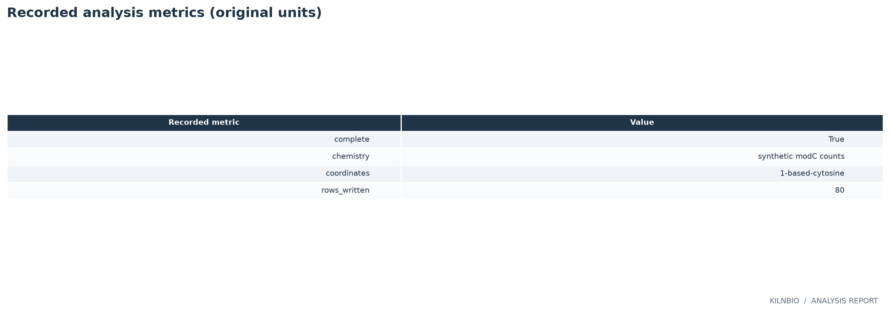](import-mods__chemistry_and_scope.png)

**How to read it.** Use these recorded quantities to trace the analysis. Values with different units remain separate rather than sharing an arbitrary numeric scale.

Method and display details

Receipt values retain their individual units; they are not compared on a shared numeric axis. Up to 24 rows displayed; TSV includes all scalar entries.

[Full-size figure](import-mods__chemistry_and_scope.png) · [Plotted values (TSV)](import-mods__chemistry_and_scope.tsv)

## capture-panel

### Panel width

**Why it matters.** Measurement quality and distribution determine which comparisons the data can support.

[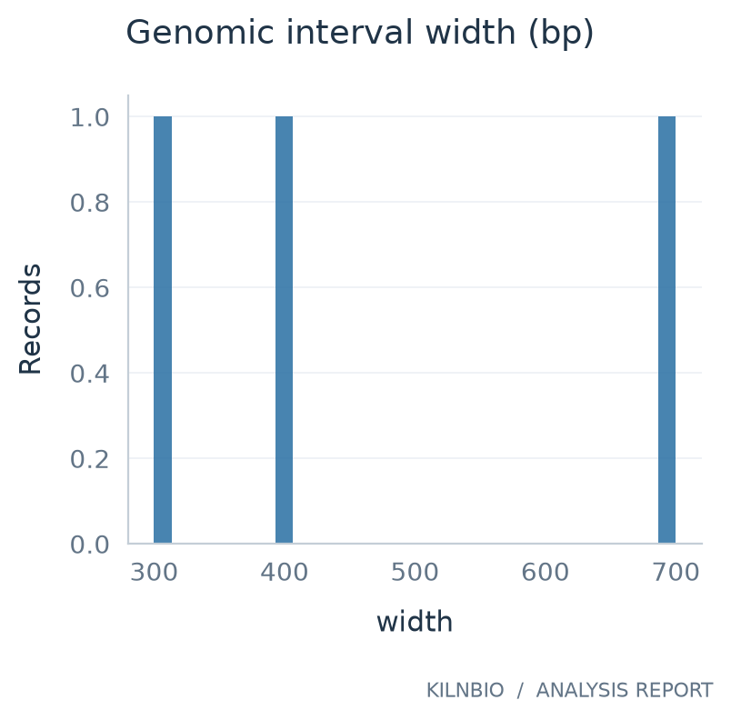](capture-panel__panel_width.png)

**How to read it.** Inspect the units, counts and unusual values alongside the source QC flags. This display summarizes the recorded measurements without changing the analysis.

Method and display details

Separate scales preserve each quantity. Histograms use the available finite values; no missing values are imputed. At most 100,000 input rows are read.

[Full-size figure](capture-panel__panel_width.png) · [Plotted values (TSV)](capture-panel__panel_width.tsv)

### Panel contigs

**Why it matters.** Measurement quality and distribution determine which comparisons the data can support.

**How to read it.** Inspect the units, counts and unusual values alongside the source QC flags. This display summarizes the recorded measurements without changing the analysis.

Method and display details

Counts of records; not a significance test. Largest 25 categories shown; TSV includes all categories read.

[Full-size figure](capture-panel__panel_contigs.png) · [Plotted values (TSV)](capture-panel__panel_contigs.tsv)

### Where the evidence occurs

**Why it matters.** Genomic context helps distinguish an isolated observation from a regional pattern and connects results to measurable loci.

**How to read it.** Inspect coordinates and local coverage together. Gaps mean no displayed measurement; they do not establish absence of an effect.

Method and display details

Each row is a separate interval; coordinates on different contigs are not a shared genomic location. This is interval geometry, not evidence of enhancer–gene linkage.

[Full-size figure](capture-panel__panel_intervals.png) · [Plotted values (TSV)](capture-panel__panel_intervals.tsv)

### Features fully on target

**Why it matters.** Measurement quality and distribution determine which comparisons the data can support.

**How to read it.** Inspect the units, counts and unusual values alongside the source QC flags. This display summarizes the recorded measurements without changing the analysis.

Method and display details

Counts of records; not a significance test. Largest 25 categories shown; TSV includes all categories read.

[Full-size figure](capture-panel__features_fully_on_target.png) · [Plotted values (TSV)](capture-panel__features_fully_on_target.tsv)

### What was actually measurable?

**Why it matters.** Apparent improvements can arise when an analysis quietly changes which samples or features it includes.

**How to read it.** Check the measured denominator and missing categories before comparing results. Coverage and eligibility are different from positive biological evidence.

Method and display details

Receipt values retain their individual units; they are not compared on a shared numeric axis. Up to 24 rows displayed; TSV includes all scalar entries.

[Full-size figure](capture-panel__panel_coverage.png) · [Plotted values (TSV)](capture-panel__panel_coverage.tsv)

## genomic-panel

### What was actually measurable?

**Why it matters.** Apparent improvements can arise when an analysis quietly changes which samples or features it includes.

**How to read it.** Check the measured denominator and missing categories before comparing results. Coverage and eligibility are different from positive biological evidence.

Method and display details

Counts of records; not a significance test. Largest 25 categories shown; TSV includes all categories read.

[Full-size figure](genomic-panel__genomic_states.png) · [Plotted values (TSV)](genomic-panel__genomic_states.tsv)

### Genomic states and candidate evidence

**Why it matters.** Variant-level evidence helps connect inherited or acquired genomic differences to other molecular measurements.

[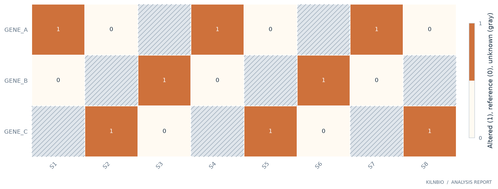](genomic-panel__genomic_oncoprint.png)

**How to read it.** Check observed state, allele fraction, depth and review flags. Unknown calls stay distinct from reference calls, and research candidates still require appropriate confirmation.

Method and display details

States come from reviewed calls. Missing or unknown entries are never converted to reference; this view does not infer clinical CH status.

[Full-size figure](genomic-panel__genomic_oncoprint.png) · [Plotted values (TSV)](genomic-panel__genomic_oncoprint.tsv)

## ch-screen

### Genomic states and candidate evidence

**Why it matters.** Variant-level evidence helps connect inherited or acquired genomic differences to other molecular measurements.

[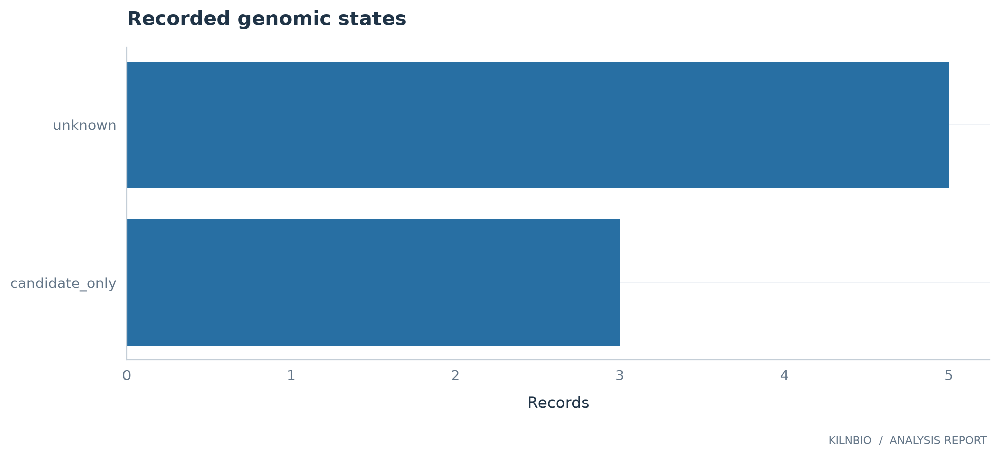](ch-screen__CH_states.png)

**How to read it.** Check observed state, allele fraction, depth and review flags. Unknown calls stay distinct from reference calls, and research candidates still require appropriate confirmation.

Method and display details

Counts of records; not a significance test. Largest 25 categories shown; TSV includes all categories read.

[Full-size figure](ch-screen__CH_states.png) · [Plotted values (TSV)](ch-screen__CH_states.tsv)

### Genomic states and candidate evidence

**Why it matters.** Variant-level evidence helps connect inherited or acquired genomic differences to other molecular measurements.

[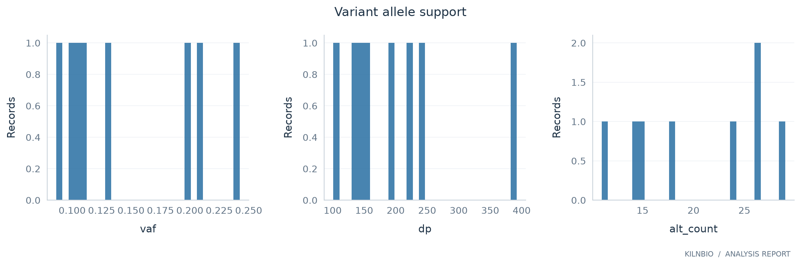](ch-screen__variants_alleles.png)

**How to read it.** Check observed state, allele fraction, depth and review flags. Unknown calls stay distinct from reference calls, and research candidates still require appropriate confirmation.

Method and display details

Separate scales preserve each quantity. Histograms use the available finite values; no missing values are imputed. At most 100,000 input rows are read.

[Full-size figure](ch-screen__variants_alleles.png) · [Plotted values (TSV)](ch-screen__variants_alleles.tsv)

### Variants gene

**Why it matters.** Measurement quality and distribution determine which comparisons the data can support.

**How to read it.** Inspect the units, counts and unusual values alongside the source QC flags. This display summarizes the recorded measurements without changing the analysis.

Method and display details

Counts of records; not a significance test. Largest 25 categories shown; TSV includes all categories read.

[Full-size figure](ch-screen__variants_gene.png) · [Plotted values (TSV)](ch-screen__variants_gene.tsv)

### Variants candidate

**Why it matters.** Measurement quality and distribution determine which comparisons the data can support.

**How to read it.** Inspect the units, counts and unusual values alongside the source QC flags. This display summarizes the recorded measurements without changing the analysis.

Method and display details

Counts of records; not a significance test. Largest 25 categories shown; TSV includes all categories read.

[Full-size figure](ch-screen__variants_candidate.png) · [Plotted values (TSV)](ch-screen__variants_candidate.tsv)

### Variants reasons

**Why it matters.** Measurement quality and distribution determine which comparisons the data can support.

**How to read it.** Inspect the units, counts and unusual values alongside the source QC flags. This display summarizes the recorded measurements without changing the analysis.

Method and display details

Counts of records; not a significance test. Largest 25 categories shown; TSV includes all categories read.

[Full-size figure](ch-screen__variants_reasons.png) · [Plotted values (TSV)](ch-screen__variants_reasons.tsv)

## variant-annotations

### Annotation and scientific-model context

**Why it matters.** Variant and model annotations provide extra context for research prioritization when their coverage and score definitions are visible.

**How to read it.** Check matched records, model identity and score units. Different model outputs keep separate scales; annotation is distinct from experimental confirmation.

Method and display details

Counts of records; not a significance test. Largest 25 categories shown; TSV includes all categories read.

[Full-size figure](variant-annotations__annotation_clinvar_status.png) · [Plotted values (TSV)](variant-annotations__annotation_clinvar_status.tsv)

### Annotation and scientific-model context

**Why it matters.** Variant and model annotations provide extra context for research prioritization when their coverage and score definitions are visible.

[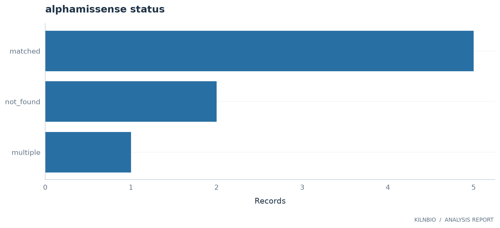](variant-annotations__annotation_alphamissense_status.png)

**How to read it.** Check matched records, model identity and score units. Different model outputs keep separate scales; annotation is distinct from experimental confirmation.

Method and display details

Counts of records; not a significance test. Largest 25 categories shown; TSV includes all categories read.

[Full-size figure](variant-annotations__annotation_alphamissense_status.png) · [Plotted values (TSV)](variant-annotations__annotation_alphamissense_status.tsv)

### Annotation and scientific-model context

**Why it matters.** Variant and model annotations provide extra context for research prioritization when their coverage and score definitions are visible.

**How to read it.** Check matched records, model identity and score units. Different model outputs keep separate scales; annotation is distinct from experimental confirmation.

Method and display details

Counts of records; not a significance test. Largest 25 categories shown; TSV includes all categories read.

[Full-size figure](variant-annotations__annotation_vep_status.png) · [Plotted values (TSV)](variant-annotations__annotation_vep_status.tsv)

## alphafold

### Annotation and scientific-model context

**Why it matters.** Variant and model annotations provide extra context for research prioritization when their coverage and score definitions are visible.

**How to read it.** Check matched records, model identity and score units. Different model outputs keep separate scales; annotation is distinct from experimental confirmation.

Method and display details

Counts of records; not a significance test. Largest 25 categories shown; TSV includes all categories read.

[Full-size figure](alphafold__structure_mapping_status.png) · [Plotted values (TSV)](alphafold__structure_mapping_status.tsv)

### Annotation and scientific-model context

**Why it matters.** Variant and model annotations provide extra context for research prioritization when their coverage and score definitions are visible.

[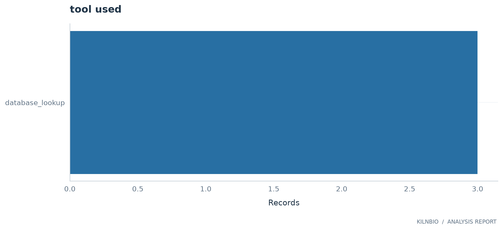](alphafold__structure_tool_used.png)

**How to read it.** Check matched records, model identity and score units. Different model outputs keep separate scales; annotation is distinct from experimental confirmation.

Method and display details

Counts of records; not a significance test. Largest 25 categories shown; TSV includes all categories read.

[Full-size figure](alphafold__structure_tool_used.png) · [Plotted values (TSV)](alphafold__structure_tool_used.tsv)

### Annotation and scientific-model context

**Why it matters.** Variant and model annotations provide extra context for research prioritization when their coverage and score definitions are visible.

[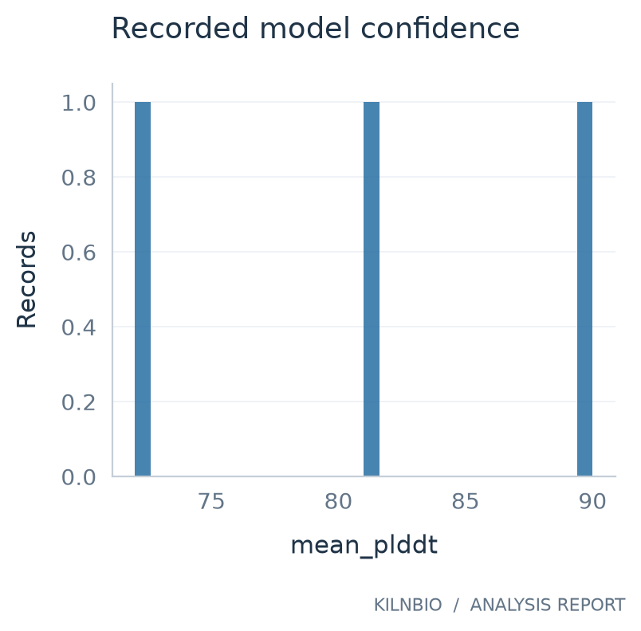](alphafold__structure_confidence.png)

**How to read it.** Check matched records, model identity and score units. Different model outputs keep separate scales; annotation is distinct from experimental confirmation.

Method and display details

Separate scales preserve each quantity. Histograms use the available finite values; no missing values are imputed. At most 100,000 input rows are read.

[Full-size figure](alphafold__structure_confidence.png) · [Plotted values (TSV)](alphafold__structure_confidence.tsv)

### Annotation and scientific-model context

**Why it matters.** Variant and model annotations provide extra context for research prioritization when their coverage and score definitions are visible.

[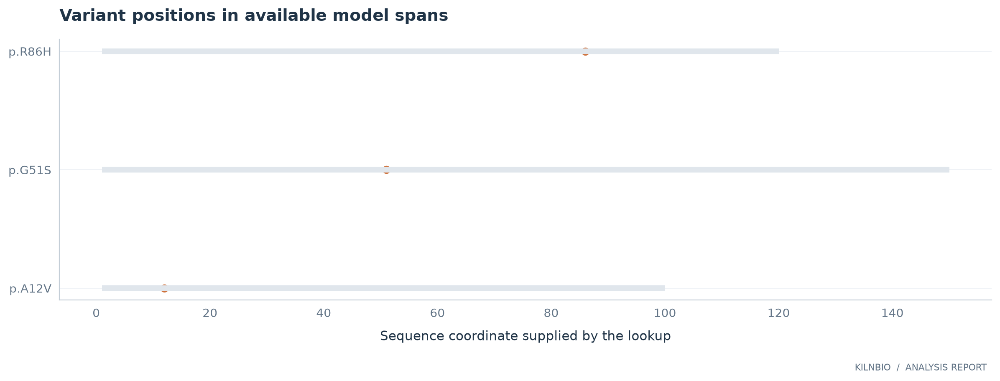](alphafold__protein_positions.png)

**How to read it.** Check matched records, model identity and score units. Different model outputs keep separate scales; annotation is distinct from experimental confirmation.

Method and display details

Model span and mapped position from the lookup receipt, not a rendered protein structure or a pathogenicity prediction.

[Full-size figure](alphafold__protein_positions.png) · [Plotted values (TSV)](alphafold__protein_positions.tsv)

## alphagenome

### Annotation and scientific-model context

**Why it matters.** Variant and model annotations provide extra context for research prioritization when their coverage and score definitions are visible.

**How to read it.** Check matched records, model identity and score units. Different model outputs keep separate scales; annotation is distinct from experimental confirmation.

Method and display details

Counts of records; not a significance test. Largest 25 categories shown; TSV includes all categories read.

[Full-size figure](alphagenome__prediction_output_type.png) · [Plotted values (TSV)](alphagenome__prediction_output_type.tsv)

### Prediction variant id

**Why it matters.** Measurement quality and distribution determine which comparisons the data can support.

[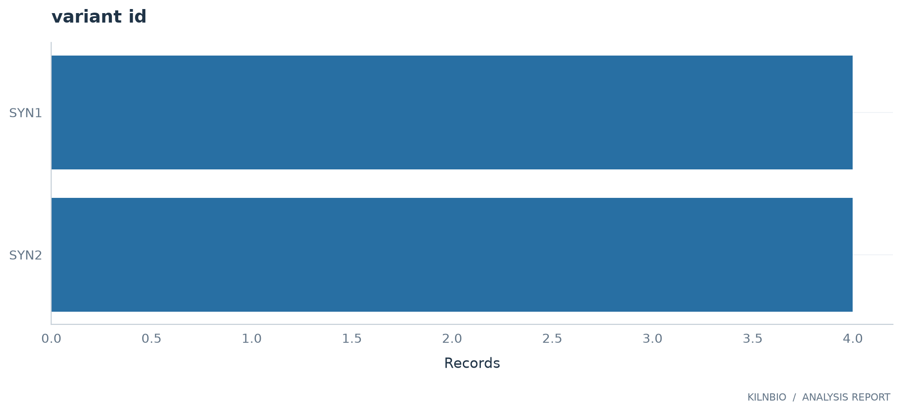](alphagenome__prediction_variant_id.png)

**How to read it.** Inspect the units, counts and unusual values alongside the source QC flags. This display summarizes the recorded measurements without changing the analysis.

Method and display details

Counts of records; not a significance test. Largest 25 categories shown; TSV includes all categories read.

[Full-size figure](alphagenome__prediction_variant_id.png) · [Plotted values (TSV)](alphagenome__prediction_variant_id.tsv)

### Annotation and scientific-model context

**Why it matters.** Variant and model annotations provide extra context for research prioritization when their coverage and score definitions are visible.

**How to read it.** Check matched records, model identity and score units. Different model outputs keep separate scales; annotation is distinct from experimental confirmation.

Method and display details

Separate scales preserve each quantity. Histograms use the available finite values; no missing values are imputed. At most 100,000 input rows are read.

[Full-size figure](alphagenome__regulatory_predictions_1.png) · [Plotted values (TSV)](alphagenome__regulatory_predictions_1.tsv)

### Annotation and scientific-model context

**Why it matters.** Variant and model annotations provide extra context for research prioritization when their coverage and score definitions are visible.

**How to read it.** Check matched records, model identity and score units. Different model outputs keep separate scales; annotation is distinct from experimental confirmation.

Method and display details

Separate scales preserve each quantity. Histograms use the available finite values; no missing values are imputed. At most 100,000 input rows are read.

[Full-size figure](alphagenome__regulatory_predictions_2.png) · [Plotted values (TSV)](alphagenome__regulatory_predictions_2.tsv)

### Analysis scope and recorded quantities

**Why it matters.** Reliable interpretation depends on knowing what ran and which denominators and units were recorded.

**How to read it.** Use these recorded quantities to trace the analysis. Values with different units remain separate rather than sharing an arbitrary numeric scale.

Method and display details

Receipt values retain their individual units; they are not compared on a shared numeric axis. Up to 24 rows displayed; TSV includes all scalar entries.

[Full-size figure](alphagenome__prediction_receipt.png) · [Plotted values (TSV)](alphagenome__prediction_receipt.tsv)

## clock-panel

### Biomarker outputs and coverage

**Why it matters.** Different biomarkers measure different constructs and may require different input features.

**How to read it.** Check model units and input coverage before comparing scores. Age, pace and other scores should not be interpreted on a common numeric scale.

Method and display details

Separate scales preserve each quantity. Histograms use the available finite values; no missing values are imputed. At most 100,000 input rows are read.

[Full-size figure](clock-panel__score_synthetic_age_years.png) · [Plotted values (TSV)](clock-panel__score_synthetic_age_years.tsv)

### Biomarker outputs and coverage

**Why it matters.** Different biomarkers measure different constructs and may require different input features.

[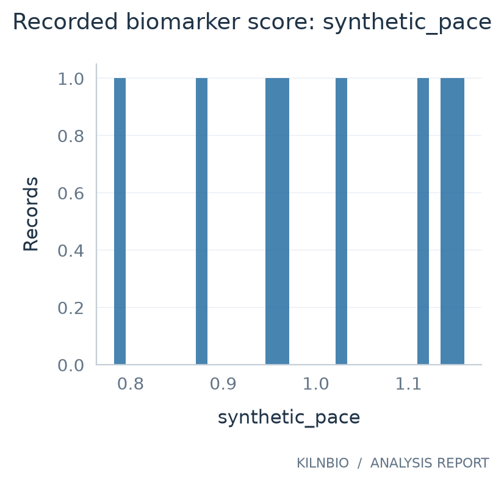](clock-panel__score_synthetic_pace.png)

**How to read it.** Check model units and input coverage before comparing scores. Age, pace and other scores should not be interpreted on a common numeric scale.

Method and display details

Separate scales preserve each quantity. Histograms use the available finite values; no missing values are imputed. At most 100,000 input rows are read.

[Full-size figure](clock-panel__score_synthetic_pace.png) · [Plotted values (TSV)](clock-panel__score_synthetic_pace.tsv)

### Sample relationships

**Why it matters.** Unexpected sample groupings or unusually dissimilar samples can change the interpretation of a downstream comparison.

[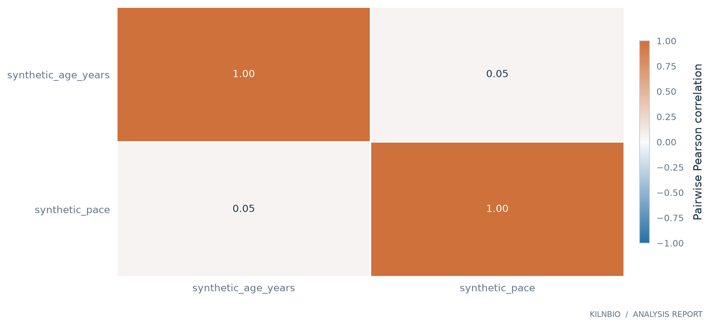](clock-panel__clock_correlation.png)

**How to read it.** Compare patterns with sample condition and batch metadata. Investigate outliers rather than removing them solely because of this plot.

Method and display details

Pairwise complete profiles (minimum three). Scores retain different endpoints; correlation does not make them interchangeable.

[Full-size figure](clock-panel__clock_correlation.png) · [Plotted values (TSV)](clock-panel__clock_correlation.tsv)

### What was actually measurable?

**Why it matters.** Apparent improvements can arise when an analysis quietly changes which samples or features it includes.

**How to read it.** Check the measured denominator and missing categories before comparing results. Coverage and eligibility are different from positive biological evidence.

Method and display details

Separate scales preserve each quantity. Histograms use the available finite values; no missing values are imputed. At most 100,000 input rows are read.

[Full-size figure](clock-panel__coverage.png) · [Plotted values (TSV)](clock-panel__coverage.tsv)

### What was actually measurable?

**Why it matters.** Apparent improvements can arise when an analysis quietly changes which samples or features it includes.

**How to read it.** Check the measured denominator and missing categories before comparing results. Coverage and eligibility are different from positive biological evidence.

Method and display details

Feature presence is distinct from complete profiles and successful scoring. Coverage does not establish transferability to a new tissue or assay.

[Full-size figure](clock-panel__clock_coverage.png) · [Plotted values (TSV)](clock-panel__clock_coverage.tsv)

## compare-assays

### Validation and uncertainty

**Why it matters.** A promising training result needs to be assessed against measured outcomes and the uncertainty in the comparison.

**How to read it.** Inspect the reference line or interval, sample denominator and endpoint definition. These panels display the supplied validation outputs.

Method and display details

Supplied held-out or out-of-fold predictions; the report does not train or select a model. The dashed line is identity, not a fitted calibration line.

[Full-size figure](compare-assays__heldout_predictions.png) · [Plotted values (TSV)](compare-assays__heldout_predictions.tsv)

### Validation and uncertainty

**Why it matters.** A promising training result needs to be assessed against measured outcomes and the uncertainty in the comparison.

**How to read it.** Inspect the reference line or interval, sample denominator and endpoint definition. These panels display the supplied validation outputs.

Method and display details

Residual pattern by supplied model, without refitting. Units are those of the outcome.

[Full-size figure](compare-assays__prediction_residuals.png) · [Plotted values (TSV)](compare-assays__prediction_residuals.tsv)

### Validation and uncertainty

**Why it matters.** A promising training result needs to be assessed against measured outcomes and the uncertainty in the comparison.

**How to read it.** Inspect the reference line or interval, sample denominator and endpoint definition. These panels display the supplied validation outputs.

Method and display details

Intervals are read from the completed analysis, not recomputed by the visualization. Their inferential scope is the scope of the source analysis.

[Full-size figure](compare-assays__comparison_intervals.png) · [Plotted values (TSV)](compare-assays__comparison_intervals.tsv)

## spikein-factors

### External-reference normalization

**Why it matters.** An external reference can help assess global changes that ordinary library-size normalization might obscure.

[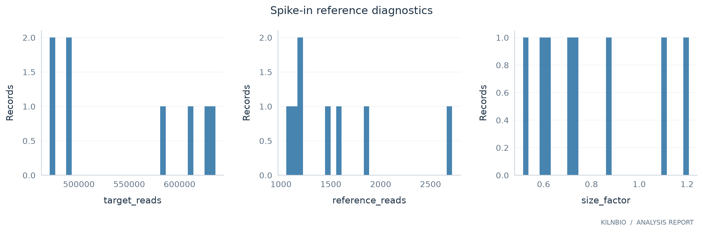](spikein-factors__spikein_counts.png)

**How to read it.** Compare target counts, reference counts and recorded factors. Interpretation depends on how the reference material was added to the experiment.

Method and display details

Separate scales preserve each quantity. Histograms use the available finite values; no missing values are imputed. At most 100,000 input rows are read.

[Full-size figure](spikein-factors__spikein_counts.png) · [Plotted values (TSV)](spikein-factors__spikein_counts.tsv)

### External-reference normalization

**Why it matters.** An external reference can help assess global changes that ordinary library-size normalization might obscure.

[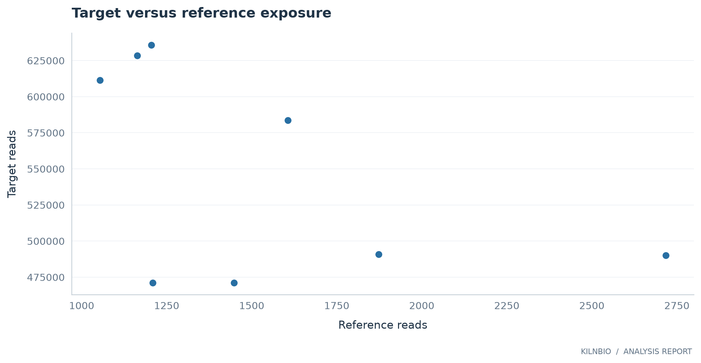](spikein-factors__spikein_exposure.png)

**How to read it.** Compare target counts, reference counts and recorded factors. Interpretation depends on how the reference material was added to the experiment.

Method and display details

Recorded target and reference counts. Reference exposure assumptions are specified by the analysis, not inferred from this correlation.

[Full-size figure](spikein-factors__spikein_exposure.png) · [Plotted values (TSV)](spikein-factors__spikein_exposure.tsv)

## assay-audit

### Analysis scope and recorded quantities

**Why it matters.** Reliable interpretation depends on knowing what ran and which denominators and units were recorded.

[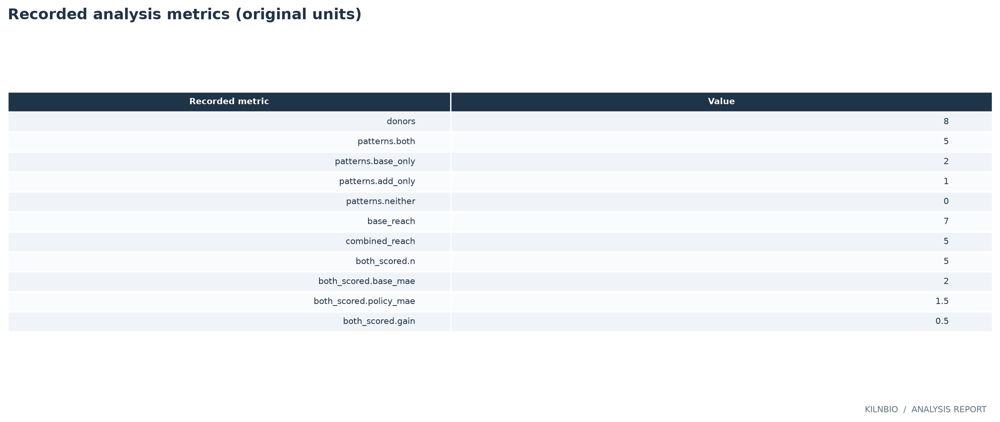](assay-audit__audit_metrics.png)

**How to read it.** Use these recorded quantities to trace the analysis. Values with different units remain separate rather than sharing an arbitrary numeric scale.

Method and display details

Receipt values retain their individual units; they are not compared on a shared numeric axis. Up to 24 rows displayed; TSV includes all scalar entries.

[Full-size figure](assay-audit__audit_metrics.png) · [Plotted values (TSV)](assay-audit__audit_metrics.tsv)

### What was actually measurable?

**Why it matters.** Apparent improvements can arise when an analysis quietly changes which samples or features it includes.

**How to read it.** Check the measured denominator and missing categories before comparing results. Coverage and eligibility are different from positive biological evidence.

Method and display details

Donor counts for the recorded assay-availability patterns; denominators come from this roster.

[Full-size figure](assay-audit__assay_reach.png) · [Plotted values (TSV)](assay-audit__assay_reach.tsv)

### Validation and uncertainty

**Why it matters.** A promising training result needs to be assessed against measured outcomes and the uncertainty in the comparison.

**How to read it.** Inspect the reference line or interval, sample denominator and endpoint definition. These panels display the supplied validation outputs.

Method and display details

Intervals are read from the completed analysis, not recomputed by the visualization. Their inferential scope is the scope of the source analysis.

[Full-size figure](assay-audit__policy_intervals.png) · [Plotted values (TSV)](assay-audit__policy_intervals.tsv)

## candidate-evidence

### Analysis scope and recorded quantities

**Why it matters.** Reliable interpretation depends on knowing what ran and which denominators and units were recorded.

**How to read it.** Use these recorded quantities to trace the analysis. Values with different units remain separate rather than sharing an arbitrary numeric scale.

Method and display details

Receipt values retain their individual units; they are not compared on a shared numeric axis. Up to 24 rows displayed; TSV includes all scalar entries.

[Full-size figure](candidate-evidence__audit_metrics.png) · [Plotted values (TSV)](candidate-evidence__audit_metrics.tsv)

### Validation and uncertainty

**Why it matters.** A promising training result needs to be assessed against measured outcomes and the uncertainty in the comparison.

**How to read it.** Inspect the reference line or interval, sample denominator and endpoint definition. These panels display the supplied validation outputs.

Method and display details

Measured endpoint confirmations remain separate from perturbation evidence. Missing evidence is not a negative experiment.

[Full-size figure](candidate-evidence__candidate_confirmation.png) · [Plotted values (TSV)](candidate-evidence__candidate_confirmation.tsv)

## graft-readouts

### Graft readouts

**Why it matters.** Measurement quality and distribution determine which comparisons the data can support.

[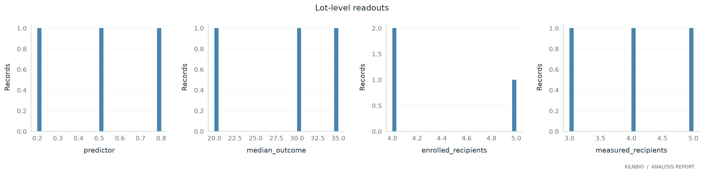](graft-readouts__graft_readouts.png)

**How to read it.** Inspect the units, counts and unusual values alongside the source QC flags. This display summarizes the recorded measurements without changing the analysis.

Method and display details

Separate scales preserve each quantity. Histograms use the available finite values; no missing values are imputed. At most 100,000 input rows are read.

[Full-size figure](graft-readouts__graft_readouts.png) · [Plotted values (TSV)](graft-readouts__graft_readouts.tsv)

## vep-annotate

### Annotation and scientific-model context

**Why it matters.** Variant and model annotations provide extra context for research prioritization when their coverage and score definitions are visible.

[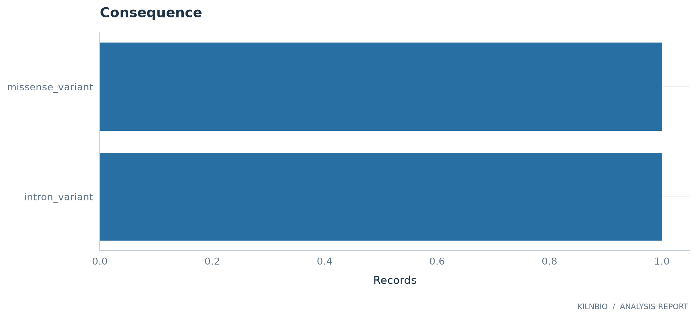](vep-annotate__vep_Consequence.png)

**How to read it.** Check matched records, model identity and score units. Different model outputs keep separate scales; annotation is distinct from experimental confirmation.

Method and display details

Counts of records; not a significance test. Largest 25 categories shown; TSV includes all categories read.

[Full-size figure](vep-annotate__vep_Consequence.png) · [Plotted values (TSV)](vep-annotate__vep_Consequence.tsv)

### Annotation and scientific-model context

**Why it matters.** Variant and model annotations provide extra context for research prioritization when their coverage and score definitions are visible.

**How to read it.** Check matched records, model identity and score units. Different model outputs keep separate scales; annotation is distinct from experimental confirmation.

Method and display details

Counts of records; not a significance test. Largest 25 categories shown; TSV includes all categories read.

[Full-size figure](vep-annotate__vep_IMPACT.png) · [Plotted values (TSV)](vep-annotate__vep_IMPACT.tsv)

### Annotation and scientific-model context

**Why it matters.** Variant and model annotations provide extra context for research prioritization when their coverage and score definitions are visible.

**How to read it.** Check matched records, model identity and score units. Different model outputs keep separate scales; annotation is distinct from experimental confirmation.

Method and display details

Counts of records; not a significance test. Largest 25 categories shown; TSV includes all categories read.

[Full-size figure](vep-annotate__vep_BIOTYPE.png) · [Plotted values (TSV)](vep-annotate__vep_BIOTYPE.tsv)

## decision-methods

### Analysis scope and recorded quantities

**Why it matters.** Reliable interpretation depends on knowing what ran and which denominators and units were recorded.

[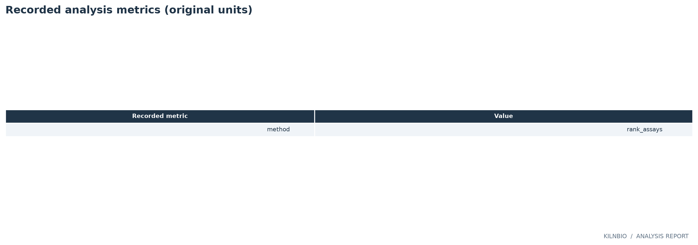](decision-methods__method_metrics.png)

**How to read it.** Use these recorded quantities to trace the analysis. Values with different units remain separate rather than sharing an arbitrary numeric scale.

Method and display details

Receipt values retain their individual units; they are not compared on a shared numeric axis. Up to 24 rows displayed; TSV includes all scalar entries.

[Full-size figure](decision-methods__method_metrics.png) · [Plotted values (TSV)](decision-methods__method_metrics.tsv)

### How prioritization changes

**Why it matters.** An additional assay or a different analysis choice is useful when its effect on the follow-up list is visible.

**How to read it.** Inspect which candidates move and compare their eligibility. Rank movement is meaningful only within the declared comparison set.

Method and display details

Same declared feature family across the arms. Rank is descriptive; it is not a p-value or a measure of independent validation.

[Full-size figure](decision-methods__assay_rank_matrix.png) · [Plotted values (TSV)](decision-methods__assay_rank_matrix.tsv)

### How prioritization changes

**Why it matters.** An additional assay or a different analysis choice is useful when its effect on the follow-up list is visible.

**How to read it.** Inspect which candidates move and compare their eligibility. Rank movement is meaningful only within the declared comparison set.

Method and display details

Negative change means a better numerical rank after the specified transition; same feature family, without a causal attribution.

[Full-size figure](decision-methods__rank_transition_1.png) · [Plotted values (TSV)](decision-methods__rank_transition_1.tsv)

## bladder-example

### How prioritization changes

**Why it matters.** An additional assay or a different analysis choice is useful when its effect on the follow-up list is visible.

**How to read it.** Inspect which candidates move and compare their eligibility. Rank movement is meaningful only within the declared comparison set.

Method and display details

Counts of records; not a significance test. Largest 25 categories shown; TSV includes all categories read.

[Full-size figure](bladder-example__shortlist_status.png) · [Plotted values (TSV)](bladder-example__shortlist_status.tsv)

### How prioritization changes

**Why it matters.** An additional assay or a different analysis choice is useful when its effect on the follow-up list is visible.

[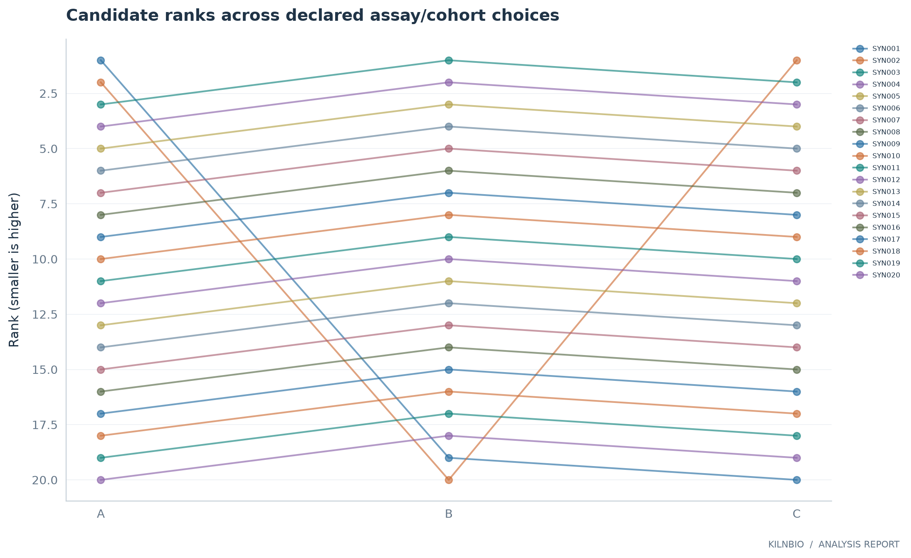](bladder-example__shortlist_rank_changes.png)

**How to read it.** Inspect which candidates move and compare their eligibility. Rank movement is meaningful only within the declared comparison set.

Method and display details

Up to 25 genes reaching the highest rank in any arm. All arms use the source recipe definitions; changing the cohort and adding an assay remain separate comparisons.

[Full-size figure](bladder-example__shortlist_rank_changes.png) · [Plotted values (TSV)](bladder-example__shortlist_rank_changes.tsv)

### What was actually measurable?

**Why it matters.** Apparent improvements can arise when an analysis quietly changes which samples or features it includes.

**How to read it.** Check the measured denominator and missing categories before comparing results. Coverage and eligibility are different from positive biological evidence.

Method and display details

Receipt values retain their individual units; they are not compared on a shared numeric axis. Up to 24 rows displayed; TSV includes all scalar entries.

[Full-size figure](bladder-example__recipe_denominators.png) · [Plotted values (TSV)](bladder-example__recipe_denominators.tsv)

## scrna

### Cell qc

**Why it matters.** Measurement quality and distribution determine which comparisons the data can support.

[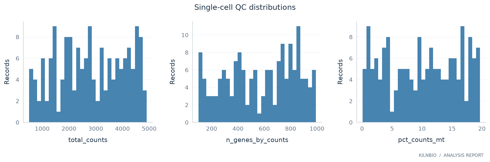](scrna__cell_qc.png)

**How to read it.** Inspect the units, counts and unusual values alongside the source QC flags. This display summarizes the recorded measurements without changing the analysis.

Method and display details

Separate scales preserve each quantity. Histograms use the available finite values; no missing values are imputed. At most 100,000 input rows are read.

[Full-size figure](scrna__cell_qc.png) · [Plotted values (TSV)](scrna__cell_qc.tsv)

### Cells qc pass

**Why it matters.** Measurement quality and distribution determine which comparisons the data can support.

[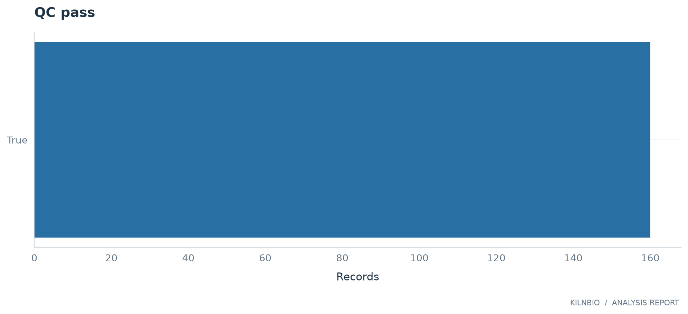](scrna__cells_qc_pass.png)

**How to read it.** Inspect the units, counts and unusual values alongside the source QC flags. This display summarizes the recorded measurements without changing the analysis.

Method and display details

Counts of records; not a significance test. Largest 25 categories shown; TSV includes all categories read.

[Full-size figure](scrna__cells_qc_pass.png) · [Plotted values (TSV)](scrna__cells_qc_pass.tsv)

### Cells sample

**Why it matters.** Measurement quality and distribution determine which comparisons the data can support.

[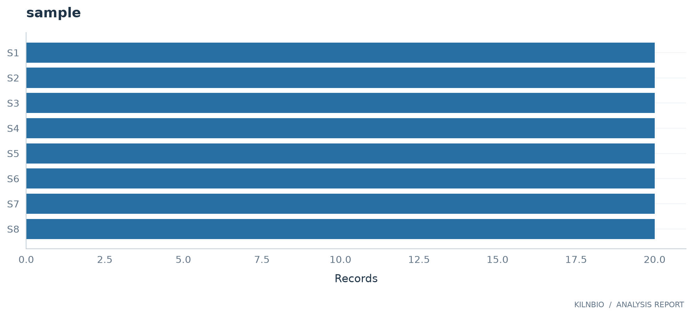](scrna__cells_sample.png)

**How to read it.** Inspect the units, counts and unusual values alongside the source QC flags. This display summarizes the recorded measurements without changing the analysis.

Method and display details

Counts of records; not a significance test. Largest 25 categories shown; TSV includes all categories read.

[Full-size figure](scrna__cells_sample.png) · [Plotted values (TSV)](scrna__cells_sample.tsv)

### Cell complexity

**Why it matters.** Measurement quality and distribution determine which comparisons the data can support.

[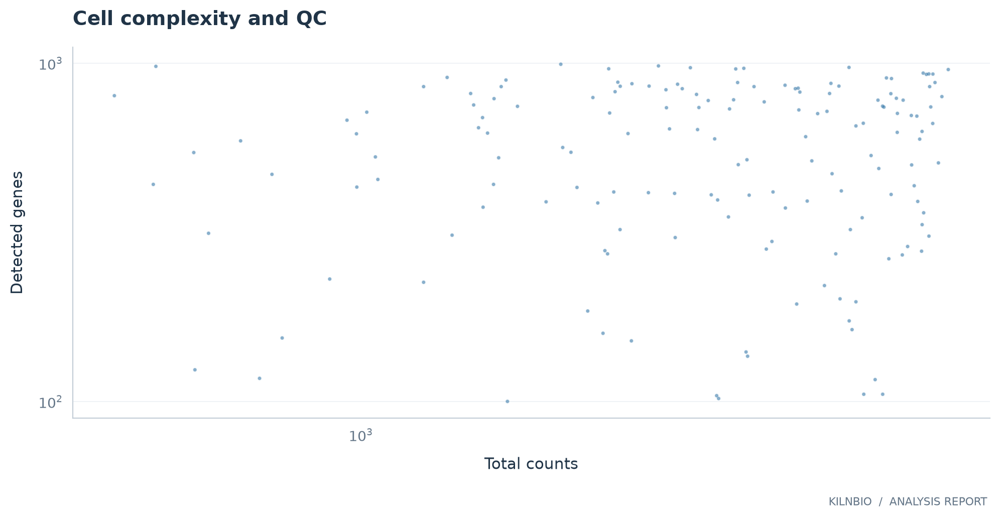](scrna__cell_complexity.png)

**How to read it.** Inspect the units, counts and unusual values alongside the source QC flags. This display summarizes the recorded measurements without changing the analysis.

Method and display details

Each point is a cell read from cell_qc.tsv; orange indicates a cell excluded by the recorded QC flags.

[Full-size figure](scrna__cell_complexity.png) · [Plotted values (TSV)](scrna__cell_complexity.tsv)

### Single-cell structure and composition

**Why it matters.** Cell populations and sample composition provide context for interpreting donor-level differences.

[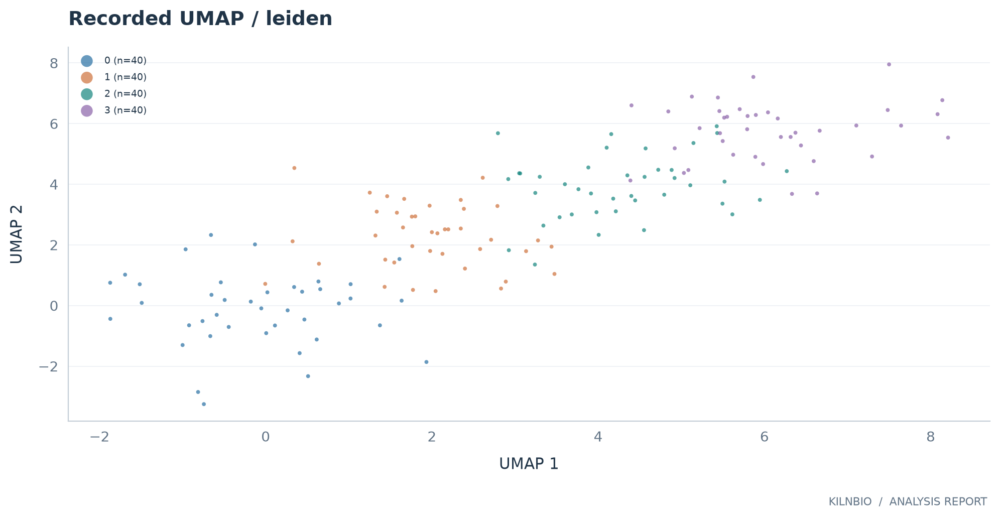](scrna__umap_leiden.png)

**How to read it.** Check sample mixing and cluster composition. Embedding distance and cluster labels are exploratory; donors remain the replication unit for comparative inference.

Method and display details

Uses the stored embedding; no re-clustering. First 10,000 retained cells displayed. Clusters are exploratory groups, not automatically validated cell types.

[Full-size figure](scrna__umap_leiden.png) · [Plotted values (TSV)](scrna__umap_leiden.tsv)

### Single-cell structure and composition

**Why it matters.** Cell populations and sample composition provide context for interpreting donor-level differences.

**How to read it.** Check sample mixing and cluster composition. Embedding distance and cluster labels are exploratory; donors remain the replication unit for comparative inference.

Method and display details

Uses the stored embedding; no re-clustering. First 10,000 retained cells displayed. Clusters are exploratory groups, not automatically validated cell types.

[Full-size figure](scrna__umap_sample.png) · [Plotted values (TSV)](scrna__umap_sample.tsv)

### Single-cell structure and composition

**Why it matters.** Cell populations and sample composition provide context for interpreting donor-level differences.

**How to read it.** Check sample mixing and cluster composition. Embedding distance and cluster labels are exploratory; donors remain the replication unit for comparative inference.

Method and display details

Uses the stored embedding; no re-clustering. First 10,000 retained cells displayed. Clusters are exploratory groups, not automatically validated cell types.

[Full-size figure](scrna__umap_total_counts.png) · [Plotted values (TSV)](scrna__umap_total_counts.tsv)

### Single-cell structure and composition

**Why it matters.** Cell populations and sample composition provide context for interpreting donor-level differences.

**How to read it.** Check sample mixing and cluster composition. Embedding distance and cluster labels are exploratory; donors remain the replication unit for comparative inference.

Method and display details

Uses the stored embedding; no re-clustering. First 10,000 retained cells displayed. Clusters are exploratory groups, not automatically validated cell types.

[Full-size figure](scrna__umap_pct_counts_mt.png) · [Plotted values (TSV)](scrna__umap_pct_counts_mt.tsv)

### Single-cell structure and composition

**Why it matters.** Cell populations and sample composition provide context for interpreting donor-level differences.

[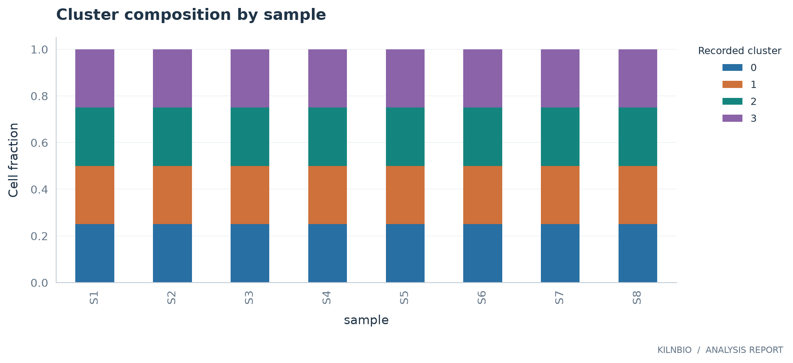](scrna__cell_composition.png)

**How to read it.** Check sample mixing and cluster composition. Embedding distance and cluster labels are exploratory; donors remain the replication unit for comparative inference.

Method and display details

Descriptive fractions among the first 10,000 retained cells. Donors, not individual cells, are the replication unit for comparative inference.

[Full-size figure](scrna__cell_composition.png) · [Plotted values (TSV)](scrna__cell_composition.tsv)

### Expression and detection by cluster

**Why it matters.** A cluster average can hide whether most cells or just a small fraction express a gene.

[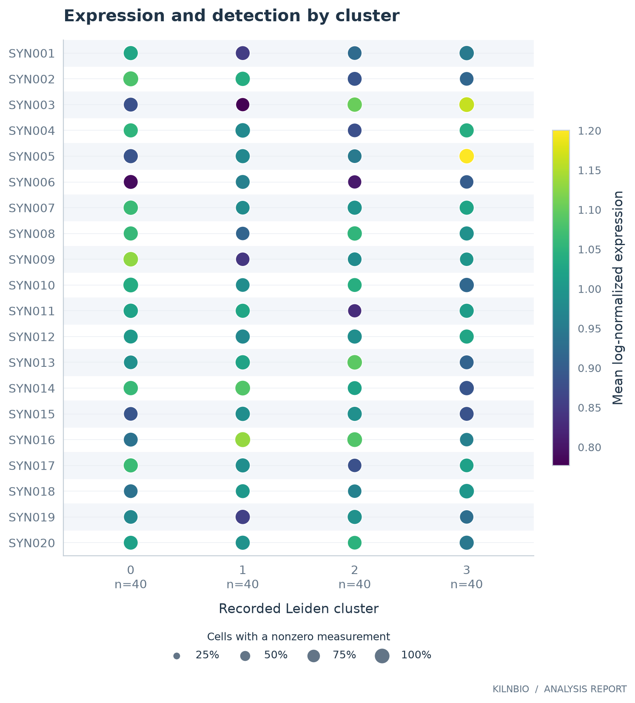](scrna__cell_expression_dotplot.png)

**How to read it.** Read color as mean expression and dot area as the fraction of cells with a nonzero measurement. These displayed genes are not automatically tested cell-type markers.

Method and display details

Dot area is the nonzero fraction; color is mean stored log-normalized expression. First 20 declared variable genes (or genes if flags absent). This is descriptive, not a differential marker test.

[Full-size figure](scrna__cell_expression_dotplot.png) · [Plotted values (TSV)](scrna__cell_expression_dotplot.tsv)

## multiomic-meta

### Evidence across assays

**Why it matters.** A candidate can look convincing in one assay while being unmeasured or discordant in another.

**How to read it.** Read each row across assays, then check measured-layer coverage and joint adjusted evidence. Color shows the declared direction; a missing cell is not a negative result.

Method and display details

Rows are aligned across evidence, measured-layer counts and joint BY q. Direction is defined by the declared orientation. Per-layer p values include feature-to-gene aggregation. Hatched gray cells are untestable; pale cells have weak evidence. Colors retain the same direction scale across all displayed assays.

[Full-size figure](multiomic-meta__evidence_heatmap.png) · [Plotted values (TSV)](multiomic-meta__evidence_heatmap.tsv)

### Ranked evidence

**Why it matters.** A prioritized list needs both an evidence scale and an explanation of how much information supports each entry.

**How to read it.** Use the axis, threshold and size legend together. Prioritization helps choose follow-up candidates; it does not make the candidates experimentally validated.

Method and display details

Orange marks selected genes; point area increases with measured layer count. Untestable rows have no point. Ranking uses raw joint p; the horizontal scale uses BY q.

[Full-size figure](multiomic-meta__combined_ranking.png) · [Plotted values (TSV)](multiomic-meta__combined_ranking.tsv)

### Agreement between molecular layers

**Why it matters.** Combining assays is more informative when agreement, disagreement and missing evidence remain distinguishable.

**How to read it.** Compare direction counts with the total declared feature set. Matching directions across assays are not automatically independent confirmations.

Method and display details

Counts include all declared genes, without a significance filter. Same direction is not independent replication. Neutral denotes tied directional evidence; not-both includes unmeasured/untestable genes.

[Full-size figure](multiomic-meta__concordance.png) · [Plotted values (TSV)](multiomic-meta__concordance.tsv)

### What was actually measurable?

**Why it matters.** Apparent improvements can arise when an analysis quietly changes which samples or features it includes.

**How to read it.** Check the measured denominator and missing categories before comparing results. Coverage and eligibility are different from positive biological evidence.

Method and display details

Exclusive measurement patterns preserve the distinction between absence of evidence and evidence of no association. The TSV contains every observed pattern.

[Full-size figure](multiomic-meta__measurement_patterns.png) · [Plotted values (TSV)](multiomic-meta__measurement_patterns.tsv)

### How prioritization changes

**Why it matters.** An additional assay or a different analysis choice is useful when its effect on the follow-up list is visible.

**How to read it.** Inspect which candidates move and compare their eligibility. Rank movement is meaningful only within the declared comparison set.

Method and display details

Each column removes one assay and holds r fixed. Average ranks handle ties within the same common testable gene set. Positive values indicate a better rank with that assay. This is sensitivity of supplied evidence, not measured predictive gain; eligibility losses are recorded separately.

[Full-size figure](multiomic-meta__rank_sensitivity.png) · [Plotted values (TSV)](multiomic-meta__rank_sensitivity.tsv)

## pathway-compare

### Pathway evidence across assays

**Why it matters.** Different molecular layers can implicate the same process through different genes.

**How to read it.** Compare pathway support across assays, then inspect coverage and contributing genes. Signed and unsigned upstream tests have different interpretations.

Method and display details

Top 25 by joint p when enabled, otherwise by minimum layer p for display only. Unsigned enrichment is plotted positive regardless of mechanism. All raw p and descriptive scores remain in the TSV.

[Full-size figure](pathway-compare__pathway_evidence.png) · [Plotted values (TSV)](pathway-compare__pathway_evidence.tsv)

### What was actually measurable?

**Why it matters.** Apparent improvements can arise when an analysis quietly changes which samples or features it includes.

**How to read it.** Check the measured denominator and missing categories before comparing results. Coverage and eligibility are different from positive biological evidence.

Method and display details

Gene coverage uses the assay-specific measured background. A large overlap does not itself establish enrichment.

[Full-size figure](pathway-compare__pathway_coverage.png) · [Plotted values (TSV)](pathway-compare__pathway_coverage.tsv)

### Genes behind pathway support

**Why it matters.** Two assays can support the same pathway using entirely different genes.

**How to read it.** Check which genes contribute and whether support is shared across layers before interpreting pathway agreement as a common mechanism.

Method and display details

Genes supplied by upstream analyses, such as leading-edge genes or ORA hits, are counted once per pathway. Empty contributions mean the upstream test did not supply gene-level support.

[Full-size figure](pathway-compare__shared_gene_support.png) · [Plotted values (TSV)](pathway-compare__shared_gene_support.tsv)

### Redundancy between pathway annotations

**Why it matters.** Closely overlapping gene sets can make one biological pattern appear to be many separate findings.

**How to read it.** Edges indicate shared annotation genes at the declared overlap threshold, not regulatory interactions. Use this view to organize related results.

Method and display details

Edges join pathways with full-GMT gene-set Jaccard overlap >= 0.25. This shows annotation redundancy, not molecular interactions or independent biological confirmations.

[Full-size figure](pathway-compare__pathway_overlap.png) · [Plotted values (TSV)](pathway-compare__pathway_overlap.tsv)

## enrich

### Ranked evidence

**Why it matters.** A prioritized list needs both an evidence scale and an explanation of how much information supports each entry.

**How to read it.** Use the axis, threshold and size legend together. Prioritization helps choose follow-up candidates; it does not make the candidates experimentally validated.

Method and display details

Point area encodes -log10(FDR q), capped at 16; position and color encode NES. Negative NES means enrichment toward the negative end of the supplied ranking.

[Full-size figure](enrich__pathway_ranking.png) · [Plotted values (TSV)](enrich__pathway_ranking.tsv)

### Genes behind pathway support

**Why it matters.** Two assays can support the same pathway using entirely different genes.

**How to read it.** Check which genes contribute and whether support is shared across layers before interpreting pathway agreement as a common mechanism.

Method and display details

Blue indicates leading-edge membership; white is absence from that leading edge, not a negative gene effect. The TSV includes all leading-edge genes in the displayed pathways.

[Full-size figure](enrich__leading_edge.png) · [Plotted values (TSV)](enrich__leading_edge.tsv)

### Where enrichment is concentrated

**Why it matters.** The running score shows which portion of the full gene ranking drives a gene-set result.

**How to read it.** Read the score peak alongside hit positions and the signed ranking. Enrichment direction refers to that ranking, not proven pathway activation.

Method and display details

Native fgsea plotEnrichment output. The TSV records the full ranked universe and set membership; the separate enrichment-curves.pdf retains native vector curves.

[Full-size figure](enrich__enrichment_curve_1.png) · [Plotted values (TSV)](enrich__enrichment_curve_1.tsv)

### Where enrichment is concentrated

**Why it matters.** The running score shows which portion of the full gene ranking drives a gene-set result.

**How to read it.** Read the score peak alongside hit positions and the signed ranking. Enrichment direction refers to that ranking, not proven pathway activation.

Method and display details

Native fgsea plotEnrichment output. The TSV records the full ranked universe and set membership; the separate enrichment-curves.pdf retains native vector curves.

[Full-size figure](enrich__enrichment_curve_2.png) · [Plotted values (TSV)](enrich__enrichment_curve_2.tsv)

### Where enrichment is concentrated

**Why it matters.** The running score shows which portion of the full gene ranking drives a gene-set result.

**How to read it.** Read the score peak alongside hit positions and the signed ranking. Enrichment direction refers to that ranking, not proven pathway activation.

Method and display details

Native fgsea plotEnrichment output. The TSV records the full ranked universe and set membership; the separate enrichment-curves.pdf retains native vector curves.

[Full-size figure](enrich__enrichment_curve_3.png) · [Plotted values (TSV)](enrich__enrichment_curve_3.tsv)

## Native fitted-model diagnostics

These original R diagnostics come from fitted models on **synthetic inputs** using `tests/integration_auto_reports.py`. They retain the upstream tool design. Their original vector PDFs are available below.

### DESeq2 dispersion

**Why it matters.** Variability between biological samples affects how confidently a gene can be compared between conditions.

**How to read it.** Inspect the relationship between mean abundance, gene-wise dispersion and the fitted model trend. Use unusual values to guide model and sample checks.

[Native vector PDF](de-deseq2-dispersion.pdf)

### edgeR quasi-likelihood dispersion

**Why it matters.** The fitted variability model determines the uncertainty assigned to count-based comparisons.

**How to read it.** Inspect the dispersion pattern across abundance and the fitted trend alongside the experimental design.

[Native vector PDF](de-edger-ql-dispersion.pdf)

### limma-voom mean-variance trend

**Why it matters.** Measurements at different abundances have different precision. Voom uses the mean-variance trend to assign precision weights.

**How to read it.** Inspect the fitted trend and the range of abundances represented. The plot explains the weighting model used by the count-data fit.

[Native vector PDF](multiomic-layers-voom.pdf)
